<h1 align="center">DevOps Micro Internship</h1>

    
  

  

    
    
    
    
    
    
    
    
    
    
  

---

## 👋 About Me

Hi, I'm **Samkeliso Dube**, a Junior DevOps and Cloud Engineer from Zimbabwe.

I studied Cloud Engineering at **AltSchool Africa**, where I developed a foundation in cloud technologies and DevOps practices.

I'm using this repository to document my practical learning journey through the **DevOps Micro Internship (DMI)**. It brings together hands-on assignments, technical notes, deployment projects, troubleshooting experiences, and lessons learned.

---

## 📌 About This Repository

This repository is a rebuild of my original DevOps Micro-Internship (DMI), which I have now completed.

The LinkedIn posts linked throughout this repository are my original posts, published while I was undertaking the internship. The step-by-step documentation and walkthroughs, however, were created during the rebuild to provide a clearer record of the practical work.

As a result, some implementation details, screenshots, or presentation may differ from the original LinkedIn posts. This is expected. The walkthroughs accurately document the rebuilt work and the steps followed.

The repository brings together my learning journey, practical exercises, troubleshooting, and technical documentation in one place.

---

## 🎯 My Approach

- 📚 Learn the fundamentals.
- 🛠️ Apply knowledge through hands-on practice.
- 🔍 Troubleshoot problems and understand their causes.
- 📝 Document the process and lessons learned.
- 🚀 Keep improving through continuous practice.

---

## 🧰 My DevOps Stack

A visual record of the topics in my DevOps Micro Internship learning path. Each hexagonal badge represents one week and links to its module.

**Full stack preview:**

[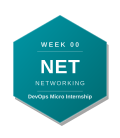](./week-00-internet-and-networking/)[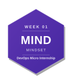](./week-01-success-mindset/)[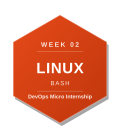](./week-02-linux-and-bash-for-devops/)[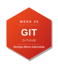](./week-04-git-and-github/)[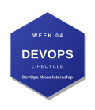](./week-05-devops-lifecycle/)[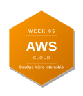](./week-06-aws-cloud/)[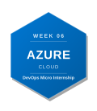](./week-07-azure-cloud/)[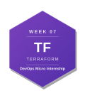](./week-08-terraform/)[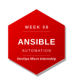](./week-09-ansible/)[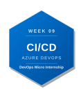](./week-10-azure-devops/)[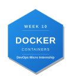](./week-11-docker/)[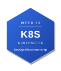](./week-12-kubernetes/)[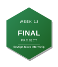](./week-13-final-project/)

---

## 🗂️ Your Stack

Unlock a weekly badge after completing that module. The badge column shows the badges you have chosen to display.

| Week | Topic | Badge |
|:---:|---|:---:|
| 00 | Internet & Networking |  |
| 01 | Success Mindset |  |
| 02 | Linux & Bash | <!--  --> |
| 03 | Git & GitHub | <!--  --> |
| 04 | DevOps Lifecycle | <!--  --> |
| 05 | AWS Cloud | <!--  --> |
| 06 | Azure Cloud | <!--  --> |
| 07 | Terraform | <!--  --> |
| 08 | Ansible | <!--  --> |
| 09 | Azure DevOps | <!--  --> |
| 10 | Docker | <!--  --> |
| 11 | Kubernetes | <!--  --> |
| 12 | Final Project | <!--  --> |

---

## 📅 Weekly Progress

I update this tracker as I work through each module and publish assignment evidence or learning posts.

**Status:** ⬜ Not Started · 🔄 In Progress · ✅ Completed

| Week | Topic | Status | Assignment | LinkedIn Post | Blog Post |
|:---:|---|:---:|:---:|:---:|:---:|
| 00 | Internet & Networking | — | — | — | — |
| 01 | Success Mindset | — | — | — | — |
| 02 | Linux & Bash | — | — | — | — |
| 03 | Git & GitHub | — | — | — | — |
| 04 | DevOps Lifecycle | — | — | — | — |
| 05 | AWS Cloud | — | — | — | — |
| 06 | Azure Cloud | — | — | — | — |
| 07 | Terraform | — | — | — | — |
| 08 | Ansible | — | — | — | — |
| 09 | Azure DevOps | — | — | — | — |
| 10 | Docker | — | — | — | — |
| 11 | Kubernetes | — | — | — | — |
| 12 | Final Project | — | — | — | — |

---

---

## 🏆 Achievements & Milestones

A collection of milestones reached throughout my DevOps learning journey.

- [x] 🚀 Started the DevOps Micro Internship (DMI).
- [x] 📦 Created and organised my GitHub learning repository.
- [x] 🐧 Gained hands-on experience with Linux.
- [x] 🌿 Practised Git and GitHub workflows.
- [x] ☁️ Completed hands-on AWS cloud deployment exercises.
- [x] 🏗️ Gained practical experience with Terraform.
- [x] 🐳 Practised containerisation with Docker.
- [x] ☸️ Explored Kubernetes fundamentals.

*More milestones will be added as I complete projects, overcome technical challenges, and expand my practical experience.*

---

## 🙏 Acknowledgements

I'm grateful to **Pravin Mishra and The CloudAdvisory** for providing the DevOps Micro Internship (DMI) learning programme and resources that have supported my learning journey.

The following resources have been useful throughout my learning:

| Resource | Link |
|---|---|
| 🌍 DMI Official Website | [DMI Website](https://dmi.pravinmishra.com/) |
| 🎓 DMI University | [DMI University](https://university.pravinmishra.com/) |
| ✍️ DMI Blog | [DMI Blog](https://dmi.pravinmishra.com/blog) |
| ▶️ DMI YouTube Playlist | [Watch on YouTube](https://www.youtube.com/playlist?list=PLFeSNDtI4Cho) |
| 💼 Pravin Mishra | [LinkedIn](https://www.linkedin.com/in/pravin-mishra-aws-trainer/) |

---

## 🤝 Let's Connect

  
  
  
  

 

  <strong>⭐ This repository documents my learning, practical work, and growth throughout the DMI programme. ⭐</strong>

  <em>If you're on a similar journey, feel free to star the repository and say hi!</em>

