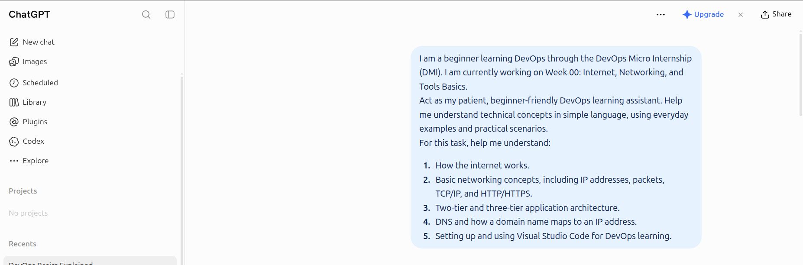
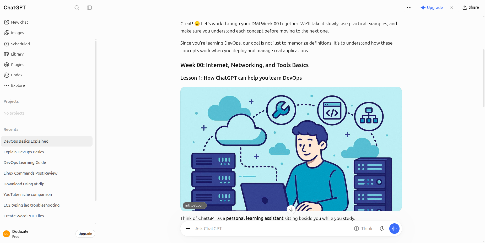
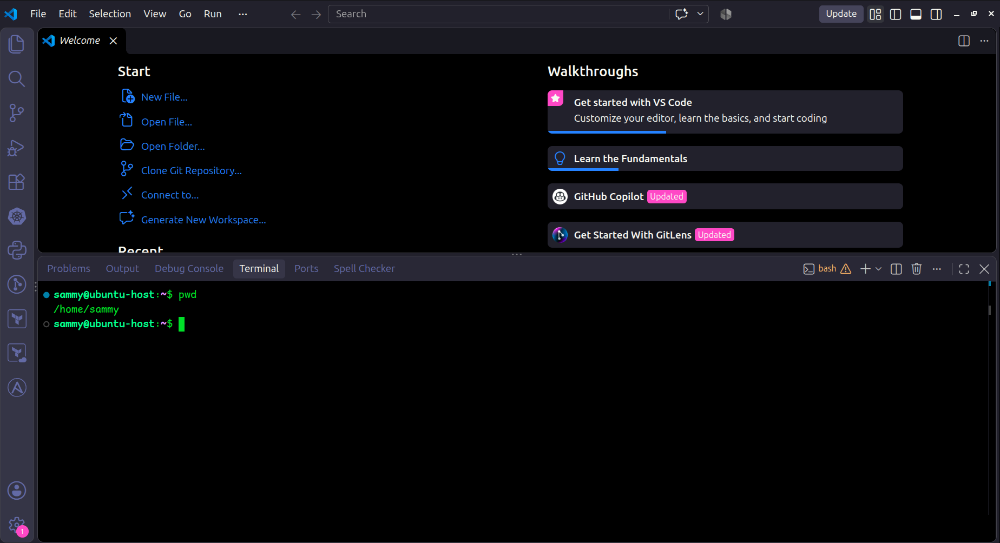
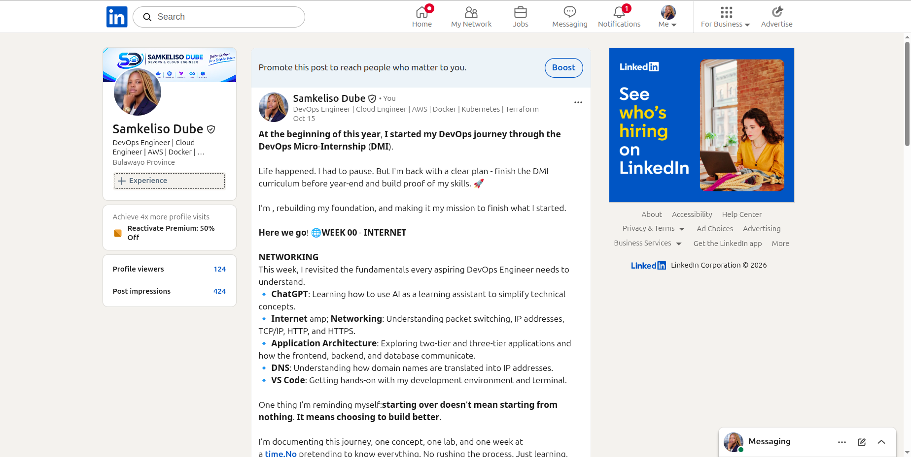

# Week 00 - Internet and Networking

---

# 🧑‍💻 Task 1: Using ChatGPT as Your Learning Assistant

## Scenario

You're new to DevOps and will frequently encounter technical questions. ChatGPT can be your learning companion.

## Your Task

Write a clear ChatGPT prompt to help you understand:

> "What is a protocol in networking? Explain with a simple real-life example."

Take a screenshot of your interaction showing:

- Your detailed prompt (with clear expectations)
- ChatGPT's simplified response with an example

## Screenshot

Save your screenshot in the `screenshots` folder and update the file name below.



**Response**



---

## What I Learned (2–3 lines)

I learned that ChatGPT can help me understand DevOps concepts by breaking complex topics into simple, manageable steps. I also learned how to ask clear questions to get more useful explanations and practical examples.

---

# 🌐 Task 2: Internet and Networking

## Scenario

Your friend is launching an online bookstore named **EpicReads**.

He asked you to explain how users globally can access his website hosted in Finland.

## Your Task

Write a short explanation (**100–150 words**) that includes:

- Packet Switching
- IP Address
- TCP/IP
- HTTP/HTTPS

💡 **Tip:** You may use ChatGPT (as demonstrated in Task 1) to refine your explanation.

## Answer

## Task 2: Internet and Networking Basics

The internet is a global network that connects computers and devices, allowing them to communicate and share information. For example, when a customer visits EpicReads, an online bookstore hosted in Finland, their request travels across the internet to the bookstore’s server.

**Packet switching** is the process of breaking data into smaller packets that travel across the network and are reassembled at their destination. An **IP address** identifies a device on a network so data can reach the correct destination. **TCP/IP** is a set of communication protocols that helps devices send, receive, and route data reliably. **HTTP** is used to transfer web pages between a browser and a server, while **HTTPS** adds encryption to help protect information exchanged between them.

These networking concepts work together to help customers access EpicReads, browse books, and place orders online.

---

# 🏗️ Task 3: Application Architecture & Stack

## Scenario

EpicReads bookstore has two application versions:

### Two-Tier Application

- Frontend
- Database

### Three-Tier Application

- Frontend
- Backend
- Database

## Your Task

- Draw simple diagrams (hand-drawn or tool-based such as draw.io)
- Label each layer clearly
- List at least two common technologies or tools used for each layer
- Submit a screenshot or photo clearly showing your own drawing

## Diagram Screenshot / Photo

**2-tier**


**3-tier**


---

## Technologies Used

### Frontend

- HTML
- CSS
- React

### Backend

- Python Flask
- Node.js
- Django

### Database

- MySQL
- PostgreSQL

---

# 🌍 Task 4: Domain Name & DNS (Basic Concepts)

## Scenario

Your friend's bookstore **EpicReads** is currently accessible through:

```text
52.172.142.222:3000
```

He purchased the domain:

```text
epicreads.com
```

## Your Task

In **50–100 words**, explain in your own words:

1. What is DNS (Domain Name System)?
2. Which DNS record type should be used to connect the domain to the given IP, and why?

## Answer

DNS (Domain Name System) translates domain names into IP addresses so that browsers can find the correct servers. For example, when someone visits epicreads.com, DNS helps the browser find the server hosting the website instead of requiring the user to remember its IP address.

To map epicreads.com to the IPv4 address 52.172.142.222, an A record is created in the domain’s DNS settings. The A record connects the domain name to that IPv4 address. When someone visits the domain, DNS can return this address so the browser knows where to send its request.

---

# 💻 Task 5: Visual Studio Code Setup (Hands-on)

## Your Task

Install Visual Studio Code (if not already installed).

Take a screenshot of your VS Code environment showing:

- Terminal open inside VS Code
- Running a basic command:

### Windows

```powershell
dir
```

### Linux / macOS

```bash
pwd
ls
```

- Your selected VS Code theme clearly visible

⚠️ **Important:** The screenshot must show your username or another identifiable detail to confirm it is your environment.

## Screenshot

## Task 5: VS Code Setup



---

# 🔗 Task 6: Publish Your Assignment as a LinkedIn Post

## Objective

Publishing on LinkedIn helps you:

- Build your professional online presence
- Reinforce your learning
- Document your DevOps journey publicly

## Your Task

Summarize your answers from Tasks 1–5 into a LinkedIn post.

Clearly structure your post into the following sections:

- ChatGPT
- Internet & Networking
- App Architecture
- DNS
- VS Code Setup

---

## LinkedIn Post URL

Paste your LinkedIn post URL here:

[View my Week 0 LinkedIn post](https://lnkd.in/p/dPP2PGHb)

---

### LinkedIn Post Backup Copy

I shared my Week 0 learning journey on LinkedIn, reflecting on internet and networking basics, application architecture, DNS, and my VS Code setup.

#### Screenshot Evidence



---

# Reflection - Week 0

### What did you find easy?

I enjoyed learning how the internet works and how devices communicate with each other

---

### What was difficult?

At first, understanding the two-tier and three-tier architectures and DNS was a bit challenging, but breaking them down helped me understand them better.
I realised that there is still a lot to learn, and I need to take my time to understand each concept properly.

---

### What will you improve next week?

Next week, I want to practise more, ask questions when I get stuck, and become more confident in what I am learning.

---


## 👩🏽‍💻 Personal Reflection

Completing this assignment helped me build a better understanding of internet and networking fundamentals. I explored how devices communicate, how application architectures are structured, and how DNS connects domain names to IP addresses.

As I continue my DevOps journey, I want to strengthen these foundations through consistent practice, hands-on projects, and documenting what I learn along the way.

## 🎯 Conclusion

Week 0 has been a valuable starting point in my DevOps learning journey. I look forward to building on these fundamentals and applying them in future practical projects.

---


**Author:** Samkeliso Dube  
**Role:** DevOps Engineer | Cloud Engineer  
**GitHub:** [Samkeliso-Dube](https://github.com/Samkeliso-dube00)  
**LinkedIn:** [Samkeliso Dube](https://www.linkedin.com/in/samkeliso-dube03/)
