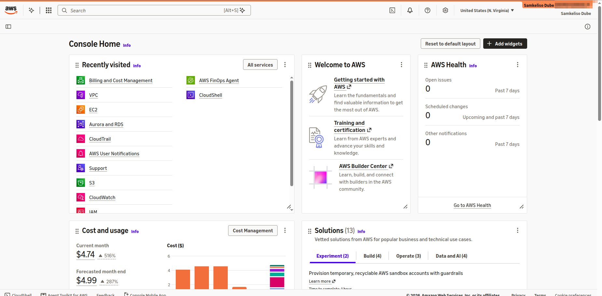

# Assignment 1 : AWS Free Tier Account Setup (EpicReads Cloud Onboarding)

---

## Purpose

In this assignment, you will create and verify an AWS Free Tier account as part of onboarding EpicReads - an online bookstore moving to the cloud. You will demonstrate an understanding of AWS fundamentals, Free Tier services, and account setup by answering conceptual questions and capturing proof of a working AWS Console login.

---

## Task 1 : Understanding AWS & Free Tier

### Goal

Demonstrate understanding of AWS basics and Free Tier usage by answering the following questions in your own words (3-4 lines each).

#### Answers

##### Question 1 : What is an AWS account, and why do you need it at this stage?

An AWS account provides access to Amazon Web Services (AWS), allowing users to create, configure, and manage cloud resources and services.

I need an AWS account at this stage of my DevOps journey so I can gain practical experience by building, testing, and deploying applications in a real cloud environment. It allows me to work with actual infrastructure, create environments, experiment with AWS services, and develop the practical skills needed for cloud and DevOps engineering.

---

##### Question 2 : What is AWS Free Tier, and how long does it last?

The AWS Free Tier is a programme that allows customers to explore and use selected AWS services at no cost, within specified usage limits.

The duration and benefits depend on the account's eligibility and the service being used. AWS offers Free Tier benefits through free trials, limited-time free offers, and Always Free offers. Therefore, users should check the current Free Tier terms and service-specific limits to avoid unexpected charges.

---

##### Question 3 : Name three AWS Free Tier services and their free usage limits.

Three AWS services that offer Free Tier benefits include:

1. **Amazon EC2:** Provides eligible customers with free usage of selected virtual machine instances within the applicable usage limits.
2. **Amazon S3:** Offers free storage within specified limits for storing objects such as application files, images, and backups.
3. **AWS Lambda:** Offers free requests and compute time within specified monthly limits, allowing users to run code without managing servers.

The exact free usage allowances depend on the AWS Free Tier offer applicable to the account and should be checked before using the services.

---

## Task 2 : Create AWS Free Tier Account

### Goal

Create a valid AWS Free Tier account and sign in to the AWS Management Console.

> No screenshots required for this task. Completion is verified through Task 3.

---

## Task 3 : Verify AWS Account

### Goal

Confirm that your AWS account setup is complete by navigating to the Account section and capturing proof.

#### Evidence

##### Screenshot 1 : AWS Account page showing account name (email may be blurred)

---

## 🎯 Conclusion

Week 2 has been a valuable part of my DevOps learning journey. I look forward to building on these fundamentals and applying them in future practical projects.

---

**Author:** Samkeliso Dube  
**Role:** DevOps Engineer | Cloud Engineer  
**GitHub:** [Samkeliso-Dube](https://github.com/Samkeliso-dube00)  
**LinkedIn:** [Samkeliso Dube](https://www.linkedin.com/in/samkeliso-dube03/)
