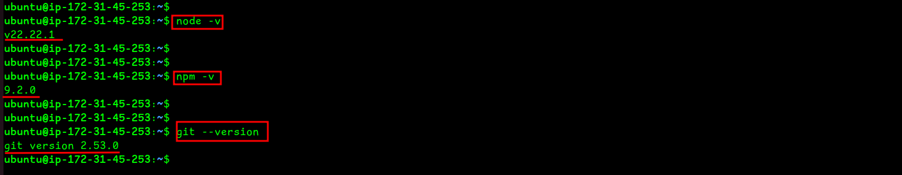
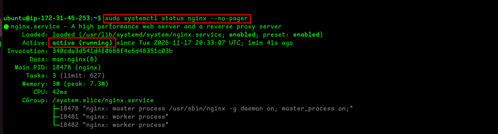
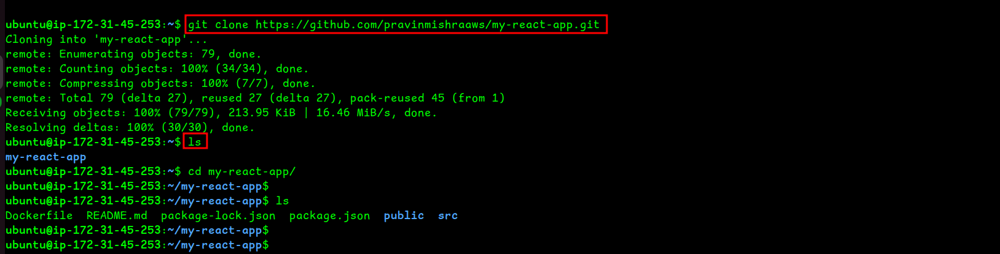
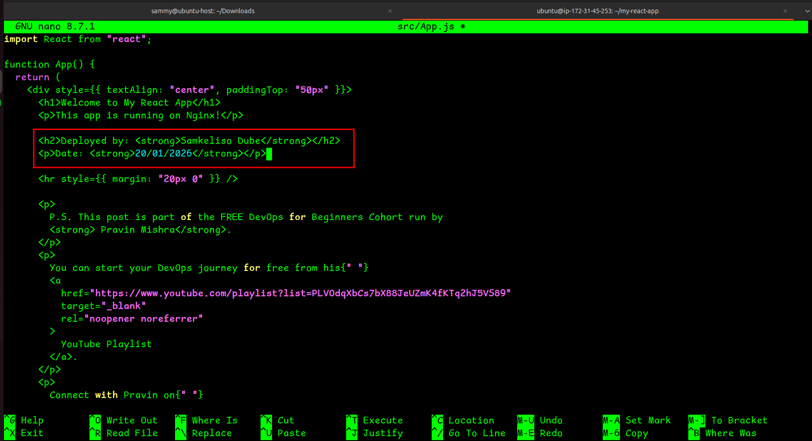
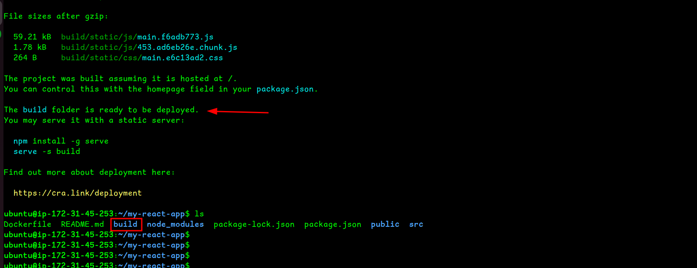
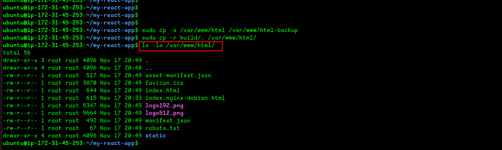
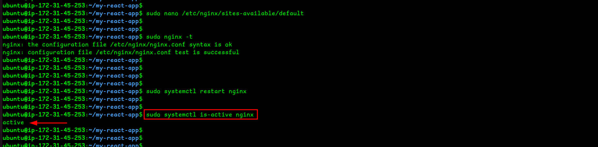
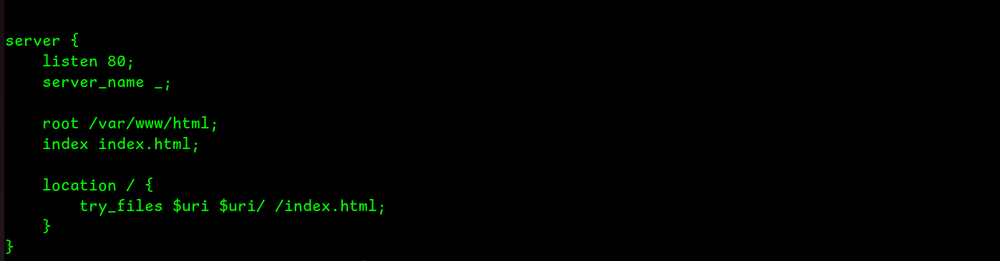
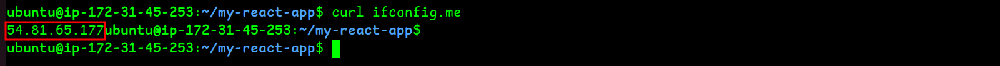
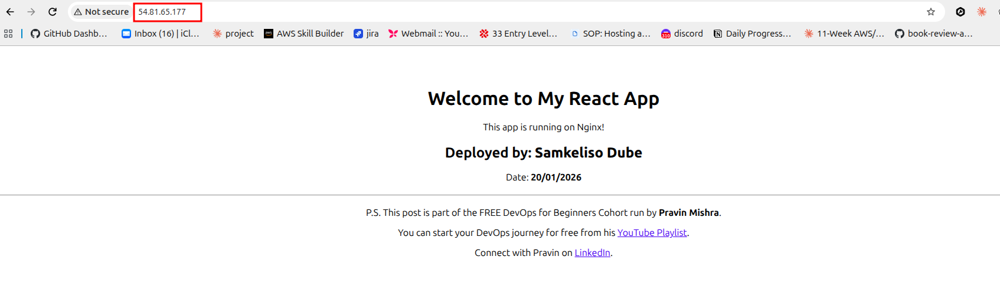

# Assignment 2: Deploy a React App on Ubuntu VM Using Nginx

---

## Purpose

In this assignment, you will deploy a React application on an Ubuntu EC2 instance and serve it using Nginx. You will provision a Linux server, install the required tools, personalize the application with your details, and verify that it is publicly accessible via a browser.

---

## Task 1: Setup Environment (Node.js & npm)

## Goal

Install Node.js and npm on the Ubuntu VM and verify the installation.

## Evidence

**Screenshot 1: Output of `node -v && npm -v` showing installed versions**

---

## Task 2: Setup Environment (Nginx)

## Goal

Install Nginx, start the service, and confirm it is running.

## Evidence

**Screenshot 2: Output of `systemctl status nginx --no-pager` showing Active (running)**

---

## Task 3: Clone React Application

## Goal

Clone the project repository and verify the project files are present.

## Evidence

**Screenshot 3: Output of `ls` inside the `my-react-app` directory showing project files**

---

## Task 4 : Modify Application (Personalization)

## Goal

Update `App.js` with your full name and the current date.

## Evidence

**Screenshot 4 : `nano App.js` open showing your full name and date filled in**

---

## Task 5 : Build React Application

## Goal

Install dependencies and generate the production build.

## Evidence

**Screenshot 5 : Output of `ls` inside `my-react-app` showing the `build/` folder generated**

---

## Task 6 : Deploy React Build to Nginx Web Root

## Goal

Copy the production build files to the Nginx web root directory.

## Evidence

**Screenshot 6 : Output of `ls /var/www/html/` showing the deployed build contents**

---

## Task 7 : Configure Nginx for React Application

## Goal

Apply Nginx configuration for React routing and confirm the service is active.

## Evidence

**Screenshot 7: Output of `systemctl is-active nginx` showing `active`**

**Screenshot 8 : Output of `cat /etc/nginx/sites-available/default` showing the Nginx config**

---

## Task 8 : Test Deployment

## Goal

Verify the React application is publicly accessible via the server's public IP.

## Evidence

**Screenshot 9: Output of `curl ifconfig.me` showing the server's public IP address**

**Screenshot 10 : Browser showing the deployed React app at `http://<public-ip>` with your name and date visible**

---

## LinkedIn Post (Required)

## Evidence

**LinkedIn Post URL**

[View LinkedIn Post](https://www.linkedin.com/posts/samkeliso-dube03_devops-cloudengineering-softwareengineering-activity-7419356690745237504-O23W/)

**Update:**

The original project link remains unchanged. I've since rebuilt the application deployment and updated the screenshots to reflect the latest version of the live application.

The updated screenshots provide more accurate evidence of the completed deployment.

Thank you!

---

## 👩🏽‍💻 Personal Reflection

This assignment gave me practical experience deploying a React application on an Ubuntu EC2 instance using Nginx. I learned how to set up the environment, install the required tools, clone the application repository, build the application, and configure Nginx to serve the React application.

Through this hands-on task, I gained a better understanding of how Linux servers and web servers work together to host applications. I also learned the importance of following deployment steps carefully and verifying that the application is accessible through a browser.

## 🎯 Conclusion

This assignment strengthened my understanding of deploying web applications on AWS EC2 using Nginx. It was a valuable opportunity to apply my knowledge practically and build confidence in working with Linux servers and cloud infrastructure.

Going forward, I want to continue practising application deployments and deepen my understanding of the tools and technologies used in DevOps.

---

**Author:** Samkeliso Dube  
**Role:** DevOps Engineer | Cloud Engineer  
**GitHub:** [Samkeliso-Dube](https://github.com/Samkeliso-dube00)  
**LinkedIn:** [Samkeliso Dube](https://www.linkedin.com/in/samkeliso-dube03/)
