# Assignment 3 — Production Maintenance Drill (OPS Checklist)

Part of the DevOps Micro Internship (DMI) with Agentic AI

---

## Purpose

In this assignment, you will treat your already deployed React application (on Ubuntu VM with Nginx) as a live production system. You will perform structured operational checks covering network validation, service health, log analysis, resource monitoring, configuration verification, and incident simulation with recovery — mirroring real on-call DevOps responsibilities.

---

# Task 1 — Server Access & Networking Validation

## Goal

Verify that the deployed React application is reachable from the browser and confirm basic network connectivity of the Ubuntu VM.

### Evidence

#### Browser showing the React application

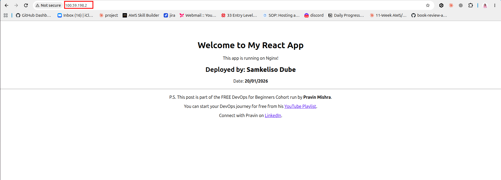

#### Network interfaces from `ip a`

#### Listening ports and processes

#### UFW firewall status

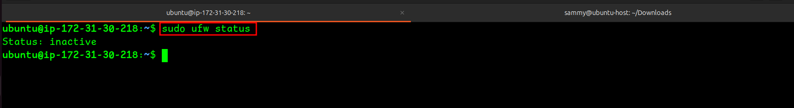

#### DNS resolution check

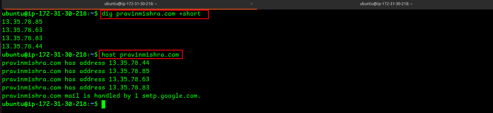

#### Network connectivity check

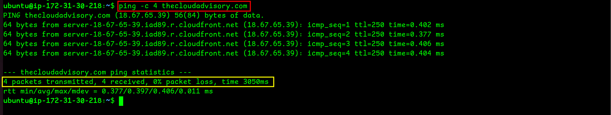

#### Routing table

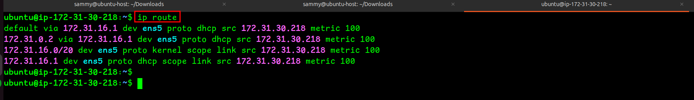

---

### Notes

Answer the following in your own words:

**1. What proves Nginx is listening on 0.0.0.0:80?**

**1. What proves Nginx is listening on 0.0.0.0:80?**

The listening-port output shows Nginx bound to `0.0.0.0:80`. `0.0.0.0` means it is listening on all IPv4 network interfaces, while port `80` is the HTTP port.

---

**2. What proves SSH is active on port 22?**

The listening-port output shows the SSH service listening on port `22`. This confirms that the VM is accepting SSH connections on that port.

---

**3. Did you find any unexpected open ports? Explain briefly.**

Use the `Listening_Ports` screenshot to identify the ports and their owning processes. Only services required for the server's role should be exposed. Record any additional listener found there before submission.

---

**2. What proves SSH is active on port 22?**

Write your answer here.

---

**3. Did you find any unexpected open ports? Explain briefly.**

Write your answer here.

---

# Task 2 — Service Health & Systemd Validation (Nginx)

## Goal

Verify that Nginx is properly installed, running, enabled at boot, and safely configured.

### Evidence

#### Nginx service status

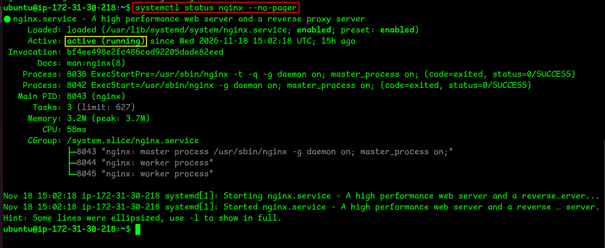

#### Nginx configuration syntax test

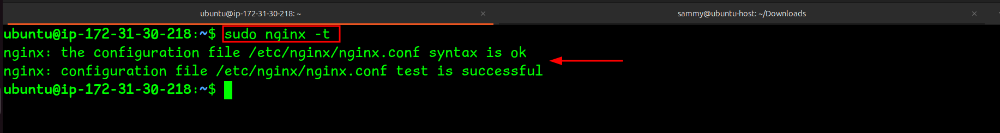

#### Nginx listening on port 80

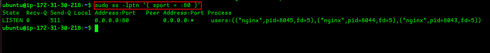

#### Nginx processes

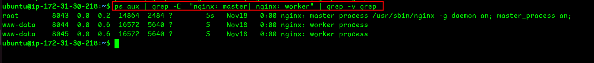

#### Nginx enabled at boot

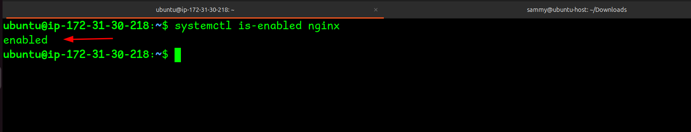

#### Nginx service restart

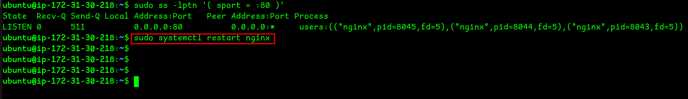

---

### Notes

Answer the following in your own words:

**1. What happens if Nginx fails to restart in production?**

If Nginx fails to restart, it may stop serving the React application. Users can receive connection errors or failed HTTP responses until the service is recovered. Validate the configuration with `sudo nginx -t` before restarting, then check the service status and test the application.

---

**2. What's your basic rollback plan?**

Keep a known-good copy of the Nginx configuration and the previous application build. If a change causes failure, restore the last working configuration or build, run `sudo nginx -t`, restart Nginx, and verify the site with a browser or `curl`.

---

# Task 3 — Logs & Request Trace

## Goal

Verify real traffic flow and analyze logs to understand system behavior and errors.

### Evidence

#### Generated HTTP traffic

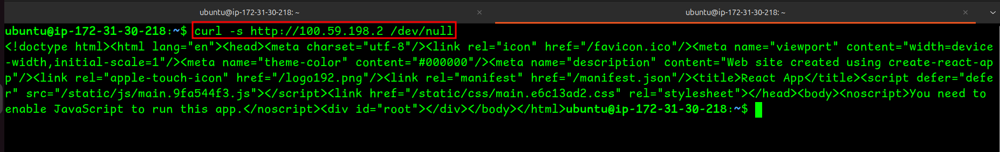

#### HTTP response status

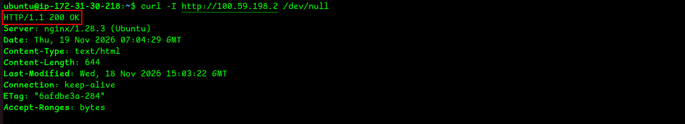

#### Nginx access log

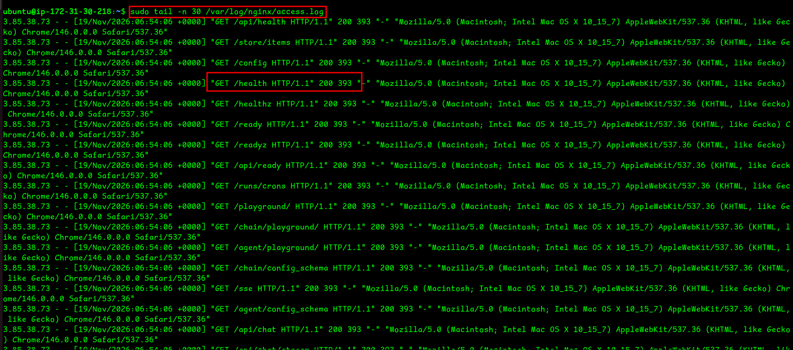

#### Nginx error log

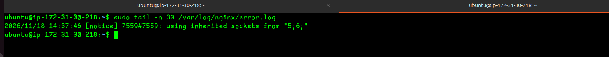

#### Nginx system journal

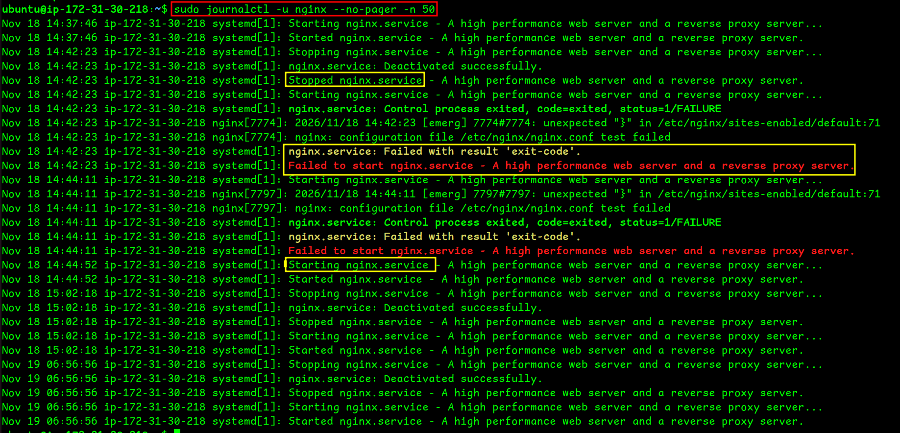

---

### Notes

Answer the following in your own words:

**1. Were there any errors in the logs?**

- If yes, mention 1–2 example error lines from the logs and explain what each one means in simple terms.
- If no, explain what it means if the error log is empty or shows no recent errors during your check.

The access and error log screenshots are the evidence for this check. Review the error log for entries and record one or two exact lines if present. Do not treat every log entry as a failure: use its message and timestamp to understand what happened.

---

**2. If there were no errors, what does that indicate about the system?**

If the error log contains no relevant errors during the test window, that is a positive sign that Nginx did not report application-serving or configuration errors at that time. It does not prove that every part of the system is error-free.

---

**3. Based on the access logs, were your curl requests visible in the log entries? What does that prove about traffic flow?**

The generated requests should appear in the Nginx access log with their request paths and HTTP status codes. This confirms that the requests reached Nginx and were recorded by its access-logging mechanism.

---

# Task 4 — System Resource Health Check (Capacity Red Flags)

## Goal

Assess server capacity and detect potential performance or failure risks.

### Evidence

#### Server uptime and load

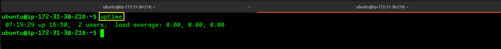

#### Memory usage

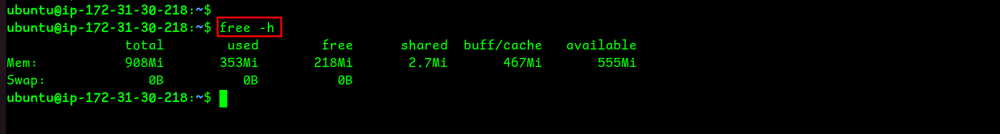

#### Filesystem disk usage

#### Directory sizes under `/var`

---

### Notes

Answer the following in your own words:

**1. Which resource looks most critical right now? (CPU/load, memory, or disk) Explain why.**

Compare the captured `uptime`, `free -h`, and `df -h` outputs. The most critical resource is the one showing the least available headroom or unusually high utilisation. Record the actual value from the screenshots rather than guessing.

---

**2. What happens if disk becomes 100% full in a production server?**

When a production disk reaches 100% usage, applications may fail to write files, logs may stop updating, package operations can fail, and services may become unstable. Investigate large files and directories, then free space safely without deleting files blindly.

---

# Task 5 — Configuration & Deployment Verification

## Goal

Ensure the correct React build is deployed and Nginx is serving it properly.

### Evidence

#### Deployed web-root files

#### Nginx `try_files` configuration

---

### Notes

Answer the following in your own words:

**1. How do you confirm that the correct version of the application is deployed?**

The web-root listing confirms which build files are present, while the Nginx `try_files` setting shows how requests are handled. A complete check also verifies the deployed identity marker. That identity-marker search was not completed during this work session, so do not claim that the deployment identity was verified yet.

---

# Task 6 — Nginx Configuration Failure Simulation

## Goal

Simulate a real-world Nginx misconfiguration and recover the service safely.

### Evidence

#### Broken Nginx configuration test

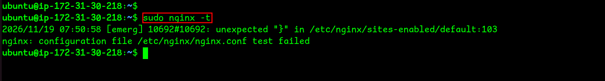

#### Corrected Nginx configuration

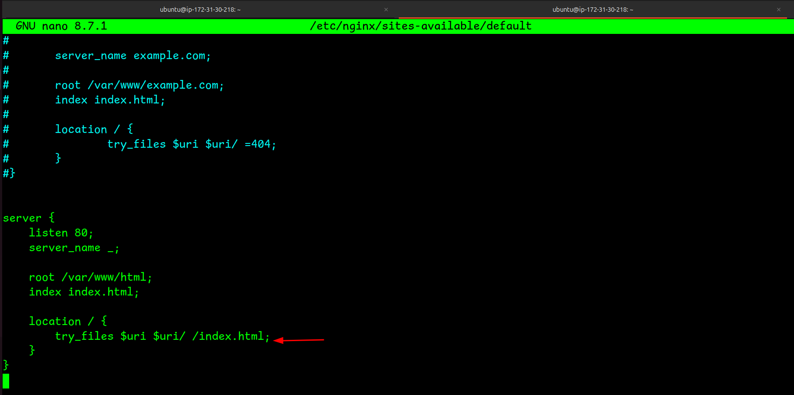

#### Validated Nginx configuration

#### Nginx service restart after correction

#### Application response after recovery

---

### Notes

Answer the following in your own words:

**1. What caused the configuration failure?**

The failure was caused by an intentional syntax error introduced into the Nginx site configuration. Nginx rejected the invalid configuration during its syntax test.

---

**2. How did you fix the issue?**

The invalid configuration was corrected, then `sudo nginx -t` was run again to validate the syntax. Nginx was restarted only after the configuration test passed, and the application response was checked to confirm recovery.

---

**3. How can you avoid this kind of issue in real production systems?**

Validate configuration changes with `sudo nginx -t` before reloading or restarting Nginx. Keep a backup of the last working configuration, review changes before applying them, and verify the service and HTTP response after deployment.

---

# Task 7 — Web Application Failure Simulation

## Goal

Simulate missing deployment content and recover the application safely.

### Evidence

#### Application failure verification

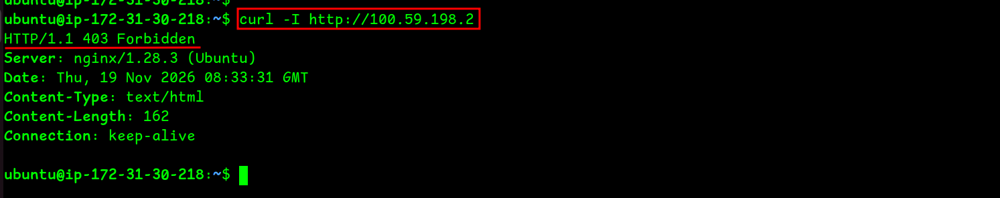

#### Empty web directory during failure

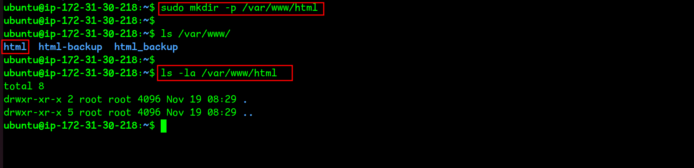

#### Application backup verification

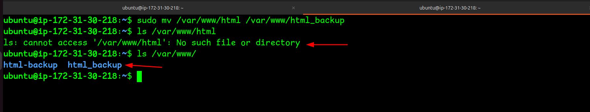

#### Restoration of application files

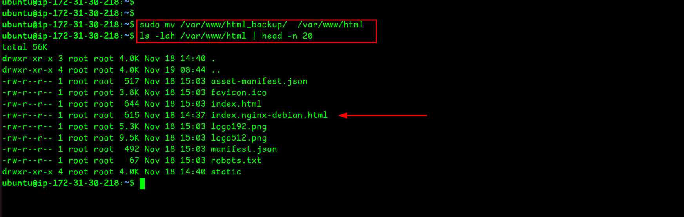

#### Application response after recovery

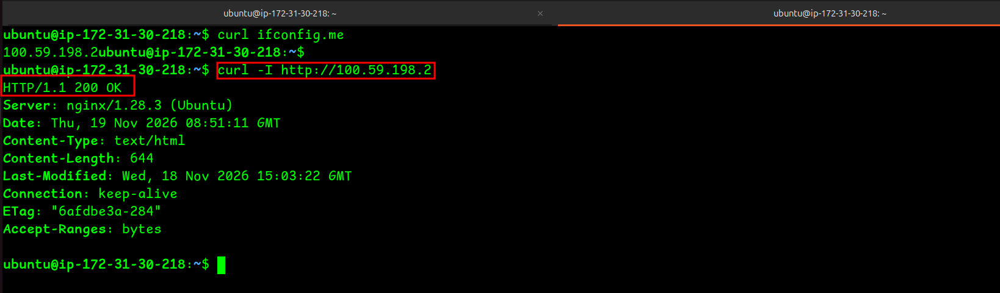

#### Nginx service restart after restoration

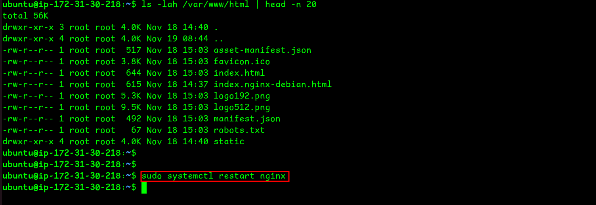

---

### Notes

Answer the following in your own words:

**1. What caused the application to break in this scenario?**

The application became unavailable because the web-root directory was emptied, removing the deployed React application files that Nginx needed to serve.

---

**2. How did you fix the issue and restore the application?**

The application files were recovered from the available backup and restored to the web root. Nginx was restarted and the HTTP response was checked again to verify that the application was serving successfully.

---

**3. What steps would you take to prevent this kind of issue in real production systems?**

Keep verified backups of each deployment, deploy new builds into a separate release directory, and switch to a release only after validation. Restrict permissions on the web root and test the site after every deployment or restoration.

---

# Task 8 — Security & Reliability Review

## Goal

Review and reflect on the security and reliability practices applied during this assignment.

### Security & Reliability Notes

Answer the following in your own words:

**1. Why is SSH key-based authentication more secure than sharing passwords?**

Write your answer here.

---

**2. Why should only required ports be open on a production server?**

Write your answer here.

---

**3. Why is it important for Nginx to be enabled on boot?**

Write your answer here.

---

**4. What are the risks of sharing secrets, keys, or credentials publicly?**

Write your answer here.

---

**5. Why should cloud resources be stopped or terminated when they are no longer needed?**

Write your answer here.

---

# LinkedIn Post (Required)

## Evidence

#### LinkedIn Post URL

Paste your LinkedIn post URL here:

`Add your URL here`

---

#### Screenshot — Published LinkedIn post

Add your screenshot here.

---

# Submission Instructions

- Add all required screenshots in your submission
- Full name must be visible in required screenshots
- Do not expose sensitive information (keys, passwords, account IDs)

---

# Completion Checklist

- [ ] Task 1: Screenshots (browser, ip a, ss -tulpen, ufw status) + Notes answered
- [ ] Task 2: Screenshots (nginx status, nginx -t, ss port 80) + Notes answered
- [ ] Task 3: Screenshots (access log, error log, journalctl) + Notes answered
- [ ] Task 4: Screenshots (uptime, free -h, df -h, du -sh) + Notes answered
- [ ] Task 5: Screenshots (ls html, grep deployed by, grep try_files) + Notes answered
- [ ] Task 6: Screenshots (nginx -t fail, nginx -t pass, curl recovery) + Notes answered
- [ ] Task 7: Screenshots (curl failure, curl recovery) + Notes answered
- [ ] Task 8: Security & Reliability Notes answered
- [ ] LinkedIn post published and URL submitted
- [ ] Full Name visible in all required screenshots
- [ ] No sensitive data exposed

---

## 📌 About DMI & CloudAdvisory

DevOps Micro Internship (DMI) is a project-based DevOps program run by Pravin Mishra (The CloudAdvisory) focused on real-world execution, systems thinking, and career readiness.

It helps learners build strong DevOps foundations with hands-on experience.

---

## 📌 Resources

- 🌐 DMI Official Website: https://dmi.pravinmishra.com?utm_source=github&utm_medium=readme  
- 🎓 University: https://university.pravinmishra.com?utm_source=github&utm_medium=readme  
- 💬 Discord Community: https://discord.pravinmishra.com?utm_source=github&utm_medium=readme  
- 📝 Blog: https://dmi.pravinmishra.com/blog?utm_source=github&utm_medium=readme  
- ▶️ YouTube Playlist: https://www.youtube.com/playlist?list=PLFeSNDtI4Cho  
- 🔗 Pravin Mishra (LinkedIn): https://www.linkedin.com/in/pravin-mishra-aws-trainer/  
- 🏢 CloudAdvisory (LinkedIn): https://www.linkedin.com/company/thecloudadvisory/

---

*This submission is part of DevOps Micro Internship (DMI) — Agentic AI Track.*