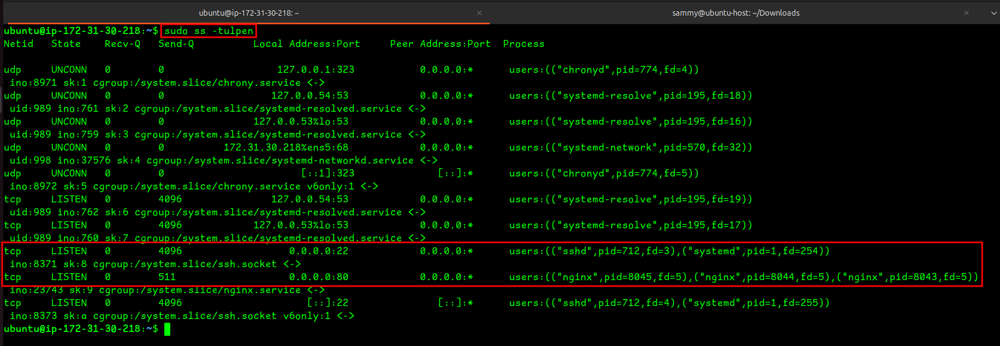
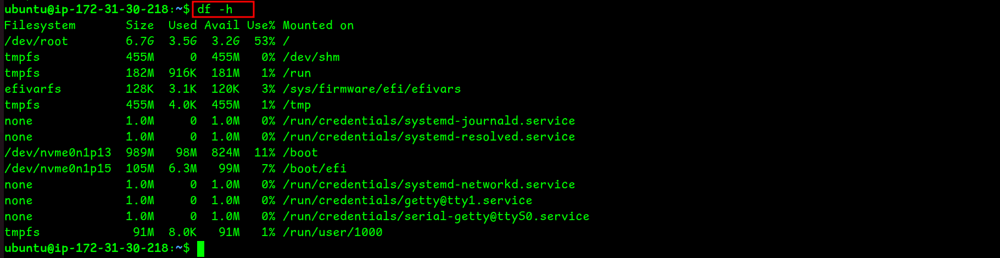
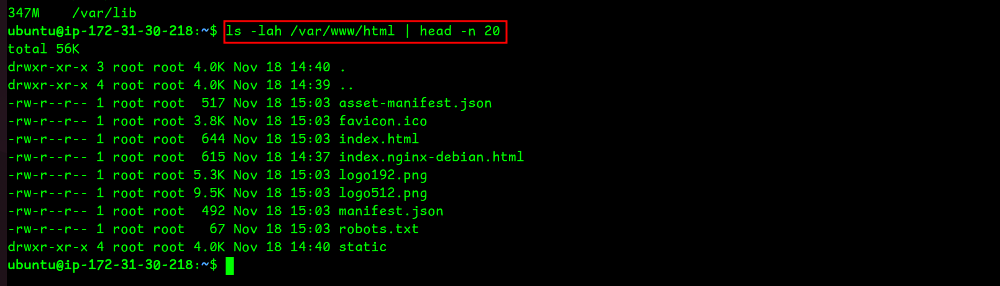
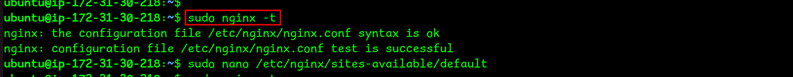
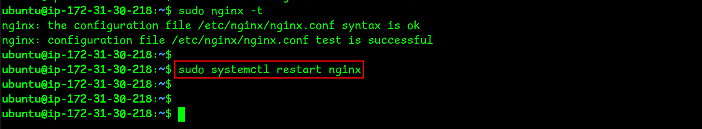
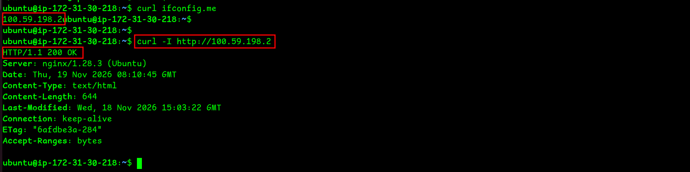

# Assignment 3 : Production Maintenance Drill (OPS Checklist)

---

## Purpose

In this assignment, you will treat your already deployed React application (on Ubuntu VM with Nginx) as a live production system. You will perform structured operational checks covering network validation, service health, log analysis, resource monitoring, configuration verification, and incident simulation with recovery — mirroring real on-call DevOps responsibilities.

---

# Task 1 : Server Access & Networking Validation

## Goal

Verify that the deployed React application is reachable from the browser and confirm basic network connectivity of the Ubuntu VM.

### Evidence

#### Browser showing the React application

#### Network interfaces from `ip a`

#### Listening ports and processes 

#### UFW firewall status

---

### Notes

**1. What proves Nginx is listening on 0.0.0.0:80?**

The listening-port output shows Nginx bound to `0.0.0.0:80`. The address `0.0.0.0` means Nginx is listening on all IPv4 network interfaces, and port `80` is used for HTTP traffic.

---

**2. What proves SSH is active on port 22?**

The listening-port output shows the SSH service listening on port `22`. This confirms that the VM is accepting SSH connections on that port.

---

**3. Did you find any unexpected open ports? Explain briefly.**

No unexpected open ports were identified. The listening ports were consistent with the services running on the server, including SSH on port 22 and Nginx on port 80.

---

# Task 2 : Service Health & Systemd Validation (Nginx)

## Goal

Verify that Nginx is properly installed, running, enabled at boot, and safely configured.

### Evidence

#### Nginx service status

#### Nginx configuration syntax test

#### Nginx listening on port 80

---

### Notes

Answer the following in your own words:

**1. What happens if Nginx fails to restart in production?**

If Nginx fails to restart, it may stop serving the React application. Users can receive connection errors or failed HTTP responses until the service is recovered. Validate the configuration with `sudo nginx -t` before restarting, then check the service status and test the application.

---

**2. What's your basic rollback plan?**

Keep a known-good copy of the Nginx configuration and the previous application build. If a change causes failure, restore the last working configuration or build, run `sudo nginx -t`, restart Nginx, and verify the site with a browser or `curl`.

---

# Task 3 : Logs & Request Trace

## Goal

Verify real traffic flow and analyze logs to understand system behavior and errors.

### Evidence

#### Nginx access log

#### Nginx error log

#### Nginx system journal

---

### Notes

Answer the following in your own words:

**1. Were there any errors in the logs?**

The Nginx error log showed one notice message about Nginx using inherited sockets. I did not find any critical errors in the output I checked. This suggests that Nginx was running without reporting any serious errors during the inspection.

---

**2. If there were no errors, what does that indicate about the system?**

This is a positive sign because Nginx did not report any relevant errors during the inspection. It suggests that the service was operating normally at that time. However, the absence of errors in the log does not guarantee that the entire system is free from problems.

---

**3. Based on the access logs, were your curl requests visible in the log entries? What does that prove about traffic flow?**

Yes, the curl requests were expected to appear in the Nginx access log, showing the requested paths and their HTTP status codes. This confirms that the requests reached Nginx and were recorded by its access-logging mechanism.

---

# Task 4 : System Resource Health Check (Capacity Red Flags)

## Goal

Assess server capacity and detect potential performance or failure risks.

### Evidence

#### Server uptime and load

#### Memory usage

#### Filesystem disk usage

#### Directory sizes under `/var`

---

### Notes

Answer the following in your own words:

**1. Which resource looks most critical right now? (CPU/load, memory, or disk) Explain why.**

Disk usage is the one I'd keep an eye on. The root filesystem is 53% full, with 3.2 GB of space still available. Memory also looks okay, with 555 MiB available, and the CPU load averages are all 0.00.

From these results, none of the resources appears to be under pressure at the moment. However, I'd monitor disk usage to make sure it doesn't get too full.

---

**2. What happens if disk becomes 100% full in a production server?**

If the disk becomes completely full, the server may start having problems. Applications might fail to save files, logs may stop recording new events, and some services may stop working properly. Even software updates or package installations can fail because there is no space left. I would check which files and directories are using the most space and safely remove unnecessary files to free up storage.

---

# Task 5 : Configuration & Deployment Verification

## Goal

Ensure the correct React build is deployed and Nginx is serving it properly.

### Evidence

#### Deployed web-root files

#### Nginx `try_files` configuration

---

### Notes

Answer the following in your own words:

**1. How do you confirm that the correct version of the application is deployed?**

I would check the web-root directory to see if the application files are there. I would also check the Nginx try_files setting to make sure it is pointing to the correct files. 

---

# Task 6 : Nginx Configuration Failure Simulation

## Goal

Simulate a real-world Nginx misconfiguration and recover the service safely.

### Evidence

#### Broken Nginx configuration test

#### Corrected Nginx configuration

#### Validated Nginx configuration

#### Nginx service restart after correction

#### Application response after recovery

---

### Notes

Answer the following in your own words:

**1. What caused the configuration failure?**

The problem was caused by a syntax error that I deliberately added to the Nginx configuration file during the test. When I ran the configuration test, Nginx detected the mistake and reported that the configuration was invalid.

---

**2. How did you fix the issue?**

I went back to the Nginx configuration file and corrected the mistake. I then ran sudo nginx -t again to make sure the configuration was valid. Once the test passed, I restarted Nginx and checked that the application was working again.

---

**3. How can you avoid this kind of issue in real production systems?**

To avoid this in production, I would always test the Nginx configuration with sudo nginx -t before applying any changes. I would also keep a backup of the working configuration so that I can restore it if something goes wrong. After making changes, I would check that Nginx is running and that the application is accessible.

---

# Task 7 : Web Application Failure Simulation

## Goal

Simulate missing deployment content and recover the application safely.

### Evidence

#### Application failure verification

#### Application response after recovery

---

### Notes

Answer the following in your own words:

**1. What caused the application to break in this scenario?**

The application became unavailable because the web-root directory was emptied, removing the deployed React application files that Nginx needed to serve.

---

**2. How did you fix the issue and restore the application?**

The application files were recovered from the available backup and restored to the web root. Nginx was restarted and the HTTP response was checked again to verify that the application was serving successfully.

---

**3. What steps would you take to prevent this kind of issue in real production systems?**

Keep verified backups of each deployment, deploy new builds into a separate release directory, and switch to a release only after validation. Restrict permissions on the web root and test the site after every deployment or restoration.

---

# Task 8 : Security & Reliability Review

## Goal

Review and reflect on the security and reliability practices applied during this assignment.

### Security & Reliability Notes

**1. Why is SSH key-based authentication more secure than sharing passwords?**

SSH key-based authentication uses a pair of keys to verify who is connecting to the server. The private key stays with the authorised user and should never be shared. This makes it more secure than sharing passwords and helps restrict SSH access to authorised users.

---

**2. Why should only required ports be open on a production server?**

Every open port can expose a service to possible attacks. During the maintenance drill, I reviewed the listening ports using sudo ss -tulpen and checked the UFW firewall status. Only the ports needed for the server's services should be accessible. This reduces unnecessary exposure and helps protect the server.

---

**3. Why is it important for Nginx to be enabled on boot?**

Enabling Nginx allows it to start automatically whenever the server reboots. This helps the application become available again without someone having to log in and start the service manually. During the drill, I checked its enablement status using systemctl is-enabled nginx.

---

**4. What are the risks of sharing secrets, keys, or credentials publicly?**

Sharing passwords, private keys, or other credentials publicly can allow unauthorised people to access servers and cloud resources. This could lead to data being exposed, services being disrupted, or unexpected cloud charges. During the drill, I made sure not to expose sensitive information in my screenshots or documentation.

---

**5. Why should cloud resources be stopped or terminated when they are no longer needed?**

Cloud resources can continue generating charges even when they are no longer being used. Leaving unnecessary resources running can also create avoidable security risks. Once a lab is complete, I should save the required evidence, check that important data is backed up, and stop or terminate resources according to the lab requirements.

# LinkedIn Post (Required)

## Evidence

**LinkedIn Post:** [View my LinkedIn post](https://www.linkedin.com/posts/samkeliso-dube03_aws-devops-cloudengineering-activity-7420524921073594368-fCza)

---

## 🎯 Conclusion

This assignment gave me practical experience carrying out production maintenance checks on an Ubuntu server running a React application with Nginx. I learned how to check service health, inspect logs, monitor system resources, verify application files, and troubleshoot configuration problems.

Through the failure simulations, I also gained a better understanding of the importance of keeping backups, validating configurations before restarting services, and checking that an application is working again after recovery. The security review helped me appreciate the importance of controlling server access, monitoring open ports, and protecting sensitive information.

Going forward, I want to continue practising these maintenance and troubleshooting skills so that I can become more confident in handling real production environments.

---

**Author:** Samkeliso Dube  
**Role:** DevOps Engineer | Cloud Engineer  
**GitHub:** [Samkeliso-Dube](https://github.com/Samkeliso-dube00)  
**LinkedIn:** [Samkeliso Dube](https://www.linkedin.com/in/samkeliso-dube03/)
