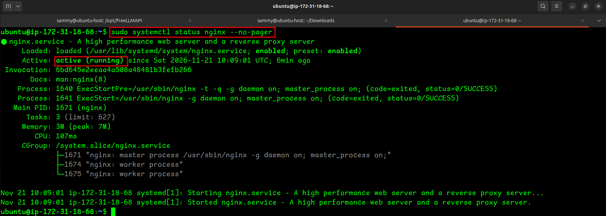
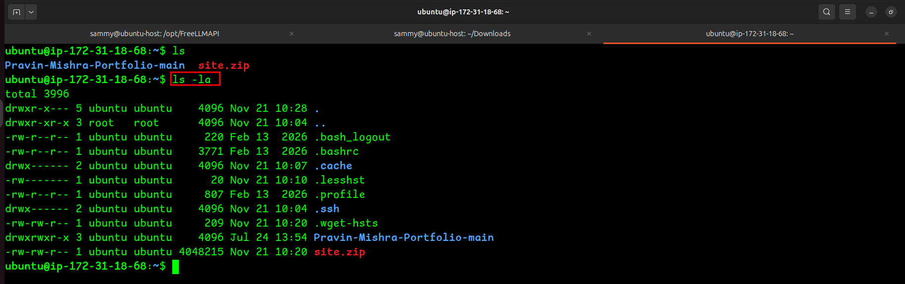
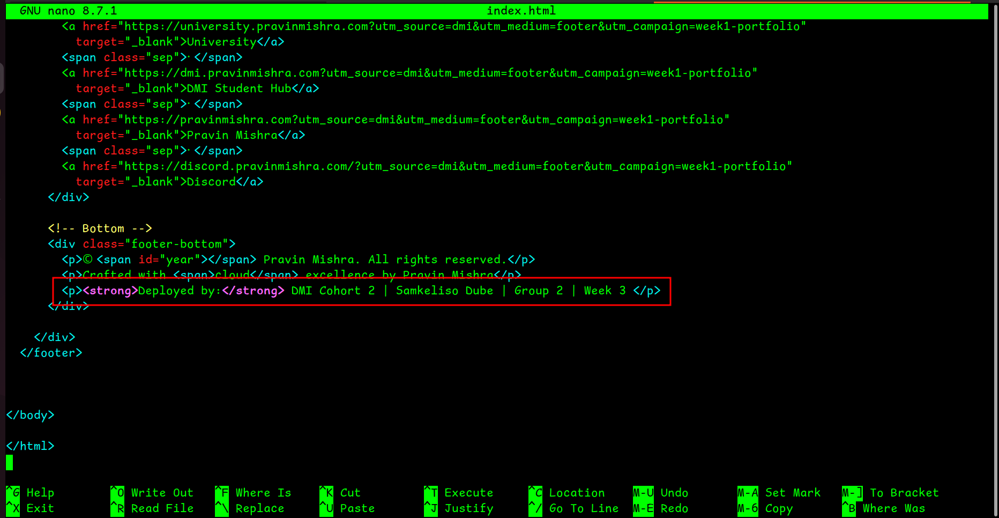
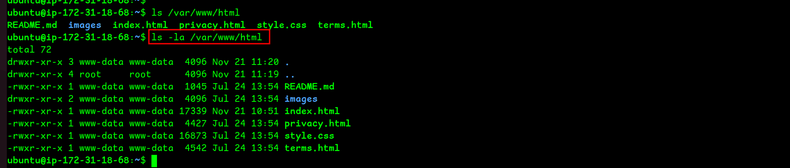
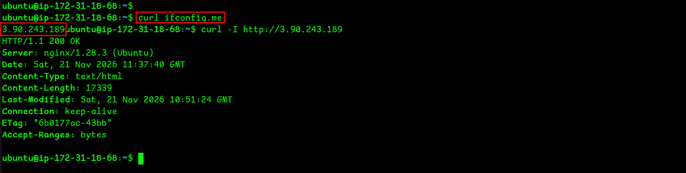
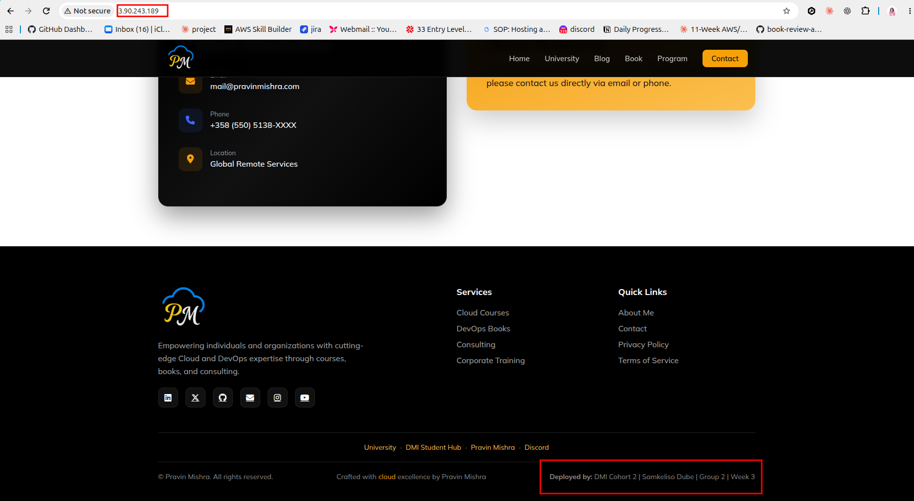
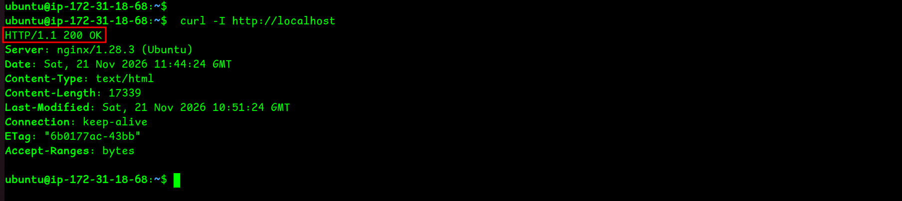

# Assignment 4 — Deploy EpicReads Portfolio Website via Nginx

Part of the DevOps Micro Internship (DMI) with Agentic AI

---

## Purpose

In this assignment, I deployed the provided portfolio website on an Ubuntu EC2 instance using Nginx. I downloaded and extracted the source code, added my ownership details to the footer, copied the website into the Nginx document root, and checked that the site was responding over HTTP.

The screenshots below show the work carried out and the results I observed on the server.

---

# Task 0 — Pre-flight Check

## Goal

Verify that the Ubuntu instance and Nginx are ready before deploying the website.

I checked the Nginx service with:

```bash
sudo systemctl status nginx --no-pager
```

The service was active and running. The output also showed that Nginx was enabled, meaning it is configured to start automatically when the instance boots.

### Evidence

#### Screenshot 0 — Nginx service status



---

# Task 1 — Get the Website Source Code

## Goal

Download and extract the portfolio website template.

I downloaded the template archive as `site.zip` and extracted it in the Ubuntu user's home directory. I then used `ls -la` to check the contents of the directory.

The extracted project folder was:

`Pravin-Mishra-Portfolio-main`

The listing also showed the downloaded `site.zip` archive, confirming that the source files were available before customisation.

### Evidence

#### Screenshot 1 — Extracted project folder



---

# Task 2 — Add Ownership Proof (Anti-Copy Change)

## Goal

Personalise the website footer so that it identifies my deployment.

I opened the website's `index.html` file in Nano and added the ownership information to the footer. The captured footer shows:

- DMI Cohort 2
- Samkeliso Dube
- Group 2
- Week 3

The screenshot confirms that the footer was edited in Nano. One detail is still outstanding: the date is not included in the displayed footer yet. I need to add the date and capture updated evidence to fully meet this requirement.

### Evidence

#### Screenshot 2 — Ownership footer in Nano



---

# Task 3 — Deploy Website via Nginx

## Goal

Copy the customised website files into Nginx's document root and check the deployment.

I inspected the Nginx web root before copying the site. The original `/var/www/html` directory had been removed, so I recreated it before deploying the files.

I copied the contents of `Pravin-Mishra-Portfolio-main` into `/var/www/html/`, set the ownership to `www-data:www-data`, and applied the required permissions.

I then ran `sudo nginx -t`. Nginx reported that the configuration syntax was OK and that the configuration test was successful.

The final directory listing showed the deployed website content, including `index.html`, `style.css`, the images directory, and the other HTML files. The listing also showed the deployed files owned by `www-data`.

### Evidence

#### Screenshot 3 — Successful Nginx configuration test


#### Screenshot 4 — Website files in the Nginx web root



---

# Task 4 — Verify Website is Live

## Goal

Check that the website can be reached through the EC2 instance's public IP address and that the personalised footer is displayed.

I used `curl ifconfig.me` to check the public IP address seen by an external service. The command returned:

`3.90.243.189`

I then used that address to test the website over HTTP. The terminal returned `HTTP/1.1 200 OK`. I also opened the address in a browser and confirmed that the portfolio website loaded.

The browser screenshot shows the site and the ownership details in the footer. The date still needs to be added to the footer, as noted in Task 2.

### Evidence

#### Screenshot 5 — Public IP check



#### Screenshot 6 — Live portfolio website



---

# Task 5 — Mini Real DevOps Operational Check

## Goal

Carry out a couple of basic checks to confirm that Nginx is enabled at boot and responds to local HTTP requests.

I ran:

```bash
systemctl is-enabled nginx
```

The output was `enabled`, confirming that Nginx is configured to start automatically during system boot.

I then tested the local HTTP endpoint using:

```bash
curl -I http://localhost
```

The response contained `HTTP/1.1 200 OK`. This confirms that Nginx returned a successful HTTP response to a request made from the EC2 instance itself.

### Evidence

#### Screenshot 7 — Nginx enabled status


#### Screenshot 8 — Local HTTP response



---

# LinkedIn Post (Mandatory)

I still need to publish the LinkedIn post and add its URL and screenshot here.

**LinkedIn Post URL:** Pending

**Evidence:** Pending — add a screenshot of the published post showing the live website and the ownership footer.

---

# Submission Summary

The server-side deployment checks and the nine required screenshots for Tasks 0–5 are included above. The following items still need attention before I can consider the submission complete:

- Add the date to the website ownership footer and replace Screenshots 2 and 6 with updated evidence.
- Publish the LinkedIn post and add its URL and screenshot.

## Completion Checklist

- [x] Screenshot 0: Nginx service status shows active/running
- [x] Screenshot 1: Website source code downloaded and extracted
- [x] Screenshot 2: Nano screenshot captured showing the ownership footer (date still needs to be added)
- [x] Screenshot 3: Nginx configuration test successful
- [x] Screenshot 4: Website files present in `/var/www/html`
- [x] Screenshot 5: Public IP retrieved
- [x] Screenshot 6: Live website opened in the browser (footer date still needs to be added)
- [x] Screenshot 7: Nginx enabled at boot
- [x] Screenshot 8: Local HTTP response returns 200 OK
- [ ] Ownership footer includes the date
- [ ] LinkedIn post published, with URL and screenshot added

---

## 📌 About DMI & CloudAdvisory

DevOps Micro Internship (DMI) is a project-based DevOps program run by Pravin Mishra (The CloudAdvisory) focused on real-world execution, systems thinking, and career readiness.

It helps learners build strong DevOps foundations with hands-on experience.

---

## 📌 Resources

- 🌐 DMI Official Website: https://dmi.pravinmishra.com?utm_source=github&utm_medium=readme
- 🎓 University: https://university.pravinmishra.com?utm_source=github&utm_medium=readme
- 💬 Discord Community: https://discord.pravinmishra.com?utm_source=github&utm_medium=readme
- 📝 Blog: https://dmi.pravinmishra.com/blog?utm_source=github&utm_medium=readme
- ▶️ YouTube Playlist: https://www.youtube.com/playlist?list=PLFeSNDtI4Cho
- 🔗 Pravin Mishra (LinkedIn): https://www.linkedin.com/in/pravin-mishra-aws-trainer/
- 🏢 CloudAdvisory (LinkedIn): https://www.linkedin.com/company/thecloudadvisory/

---

*This submission is part of DevOps Micro Internship (DMI) — Agentic AI Track.*
