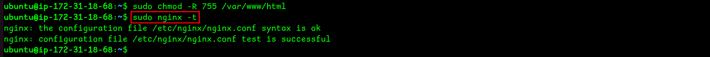
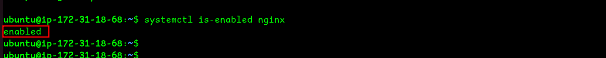

# Assignment 4 — Deploy EpicReads Portfolio Website via Nginx

Part of the DevOps Micro Internship (DMI) with Agentic AI

---

## Purpose

In this assignment, I deployed the provided portfolio website on an Ubuntu EC2 instance using Nginx. I downloaded and extracted the source code, added my ownership details to the footer, copied the website into the Nginx document root, and checked that the site was responding over HTTP.

The screenshots below show the work carried out and the results I observed on the server.

---

# Task 0 — Pre-flight Check

## Goal

Verify that the Ubuntu instance and Nginx are ready before deploying the website.

I checked the Nginx service with:

```bash
sudo systemctl status nginx --no-pager
```

The service was active and running. The output also showed that Nginx was enabled, meaning it is configured to start automatically when the instance boots.

### Evidence

#### Screenshot 0 — Nginx service status


---

# Task 1 — Get the Website Source Code

## Goal

Download and extract the portfolio website template.

I downloaded the template archive as `site.zip` and extracted it in the Ubuntu user's home directory. I then used `ls -la` to check the contents of the directory.

The extracted project folder was:

`Pravin-Mishra-Portfolio-main`

The listing also showed the downloaded `site.zip` archive, confirming that the source files were available before customisation.

### Evidence

#### Screenshot 1 — Extracted project folder


---

# Task 2 — Add Ownership Proof (Anti-Copy Change)

## Goal

Personalise the website footer so that it identifies my deployment.

I opened the website's `index.html` file in Nano and added the ownership information to the footer. The captured footer shows:

- DMI Cohort 2
- Samkeliso Dube
- Group 2
- Week 3

The screenshot confirms that the footer was edited in Nano. The date is not included in the captured footer yet, so I still need to add it and capture updated evidence to fully meet this requirement.

### Evidence

#### Screenshot 2 — Ownership footer in Nano


---

# Task 3 — Deploy Website via Nginx

## Goal

Copy the customised website files into Nginx's document root and check the deployment.

I inspected the Nginx web root before copying the site. The original `/var/www/html` directory had been removed, so I recreated it before deploying the files.

I copied the contents of `Pravin-Mishra-Portfolio-main` into `/var/www/html/`, set the ownership to `www-data:www-data`, and applied the required permissions.

I then ran `sudo nginx -t`. Nginx reported that the configuration syntax was OK and that the configuration test was successful.

The final directory listing showed the deployed website content, including `index.html`, `style.css`, the images directory, and the other HTML files. The listing also showed the deployed files owned by `www-data`.

### Evidence

#### Screenshot 3 — Successful Nginx configuration test



#### Screenshot 4 — Website files in the Nginx web root


---

# Task 4 — Verify Website is Live

## Goal

Check that the website can be reached through the EC2 instance's public IP address and that the personalised footer is displayed.

I used `curl ifconfig.me` to check the public IP address seen by an external service. The command returned:

`3.90.243.189`

I then used that address to test the website over HTTP. The terminal returned `HTTP/1.1 200 OK`. I also opened the address in a browser and confirmed that the portfolio website loaded.

The browser screenshot shows the site and the ownership details in the footer. The date still needs to be added to the footer, as noted in Task 2.

### Evidence

#### Screenshot 5 — Public IP check


#### Screenshot 6 — Live portfolio website


---

# Task 5 — Mini Real DevOps Operational Check

## Goal

Carry out a couple of basic checks to confirm that Nginx is enabled at boot and responds to local HTTP requests.

I ran:

```bash
systemctl is-enabled nginx
```

The output was `enabled`, confirming that Nginx is configured to start automatically during system boot.

I then tested the local HTTP endpoint using:

```bash
curl -I http://localhost
```

The response contained `HTTP/1.1 200 OK`. This confirms that Nginx returned a successful HTTP response to a request made from the EC2 instance itself.

### Evidence

#### Screenshot 7 — Nginx enabled status



#### Screenshot 8 — Local HTTP response


---

# LinkedIn Post

I shared the deployment as part of documenting my practical DevOps learning. The post is available here:

**Published LinkedIn post:** [Deploying a portfolio website using AWS EC2 and Nginx](https://www.linkedin.com/posts/samkeliso-dube03_devops-aws-nginx-activity-7420453917274103808--AT9)

**Post evidence screenshot:** Not yet added to the repository. I still need to save a screenshot of the published post in the screenshots folder and embed it here.

---

# Reflection

This assignment helped me understand that deploying a website is more than copying files into a web directory. I had to check the state of the server first, understand where Nginx serves files from, prepare the document root, and verify the result after deployment.

One useful lesson was the importance of checking before changing things. In this case, the original `/var/www/html` directory was no longer present, so I had to recreate it before copying the website. I also used different checks for different parts of the deployment: `nginx -t` validated the Nginx configuration, the directory listing confirmed that the website files were in place, and `curl` confirmed that the web server returned a successful HTTP response.

I also learned that a local HTTP 200 response and a website loading in a browser are different pieces of evidence. Both are useful because they test the service from different points of view. In future deployments, I want to be more deliberate about documenting every change and checking the final ownership details before taking screenshots.

# Conclusion

I successfully deployed the portfolio website to an Ubuntu EC2 instance using Nginx. The evidence shows that Nginx was running, the website files were present in the document root, the configuration test passed, the site loaded through the public IP address, and a local HTTP request returned `200 OK`. Nginx was also enabled to start automatically at boot.

There are still two submission details to finish: adding the date to the ownership footer and capturing the LinkedIn post screenshot. Once those are added, the assignment evidence will be more complete and will satisfy the remaining requirements.

