# SOP: Production Maintenance Drill for a React Application on Ubuntu EC2

**Project:** React Application Deployment and Production Maintenance  
**Environment:** AWS EC2, Ubuntu, Nginx, Linux  
**Category:** AWS / Linux / DevOps / Production Operations  
**Purpose:** Perform production health checks, validate network connectivity, analyze logs, monitor system resources, verify deployment integrity, simulate incidents, and safely recover the application.  
**Prepared by:** Samkeliso Dube  
**Method:** AWS Management Console and Linux Commands

---

## 1. 📋 Prerequisites

Before starting the production maintenance drill, ensure the following requirements are met:

- An Ubuntu EC2 instance is available.
- The React application has already been deployed.
- Nginx is installed and configured.
- The application build files are deployed to `/var/www/html`.
- SSH access to the EC2 instance is available.
- The EC2 public IP address is accessible.

**Important:** Perform all maintenance activities carefully. Back up application files before simulating failures, and never expose private keys, passwords, or AWS credentials in screenshots.

---

## 2. 🌐 Task 1 : Server Access & Networking Validation

### 2.1 Objective

Verify that the deployed React application is accessible through a web browser and inspect the Ubuntu server's network configuration.

This helps confirm that the server has working network interfaces, valid IP addresses, and the necessary connectivity to support application traffic.

### Step 1: Verify the React Application

Open a web browser and access the application using the public IP address of the EC2 instance.

```text
http://YOUR_EC2_PUBLIC_IP
```

**What this does:**

This opens the deployed React application through HTTP using the public IPv4 address assigned to the EC2 instance.

**Why this is important:**

It verifies that the application is reachable externally and that Nginx is serving the deployed frontend.

**Expected Result:**

- The React application loads successfully.
- The application displays your full name.
- The application interface is accessible through the browser.

**Screenshot Evidence:**

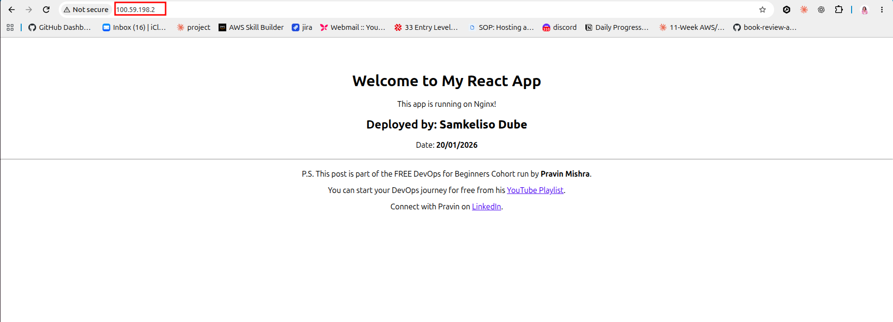

### Step 2: Inspect Network Interfaces

Run the following command on the Ubuntu EC2 instance:

```bash
ip a
```

**What this command does:**

The **ip a** command displays the network interfaces available on the server and their assigned IP addresses.

- **ip** - Linux utility for inspecting and managing network configuration.
- **a** - Short for `address`; displays assigned IP addresses.

**Why we use it:**

We use this command to identify the server's network interfaces and verify that they have been assigned IP addresses.

**What to look for:**

- **lo** - The loopback network interface.
- **eth0** or **ens5** - The EC2 network interface (the name may vary).
- **inet** - Displays an assigned IPv4 address.
- **state UP** - Indicates that the network interface is operational.

**Expected Result:**

The server's network interfaces and their assigned IP addresses should be displayed.

**Screenshot Evidence:**

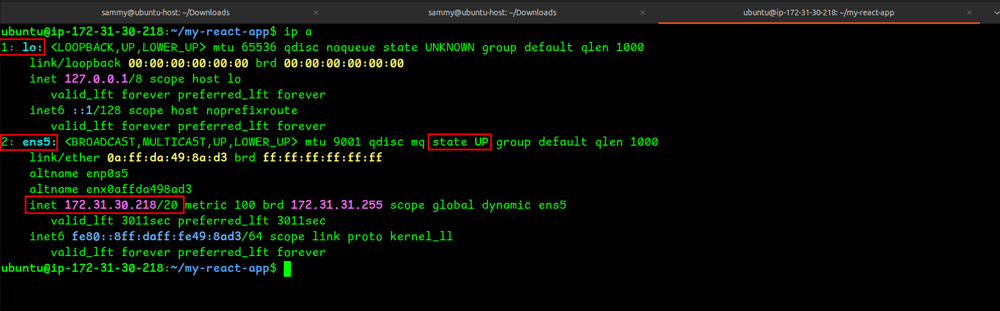

**Observation:**

> Notice that 172.31.30.218 is a private IP address, not your EC2 public IP address. AWS provides public connectivity separately through its networking infrastructure.


### Step 3: Inspect the Routing Table

Run the following command on the Ubuntu EC2 instance:

```bash
ip route
```

**What this command does:**

The `ip route` command displays the server's routing table. It shows how network traffic is directed to different destinations.

**Why we use it:**

We use this command to verify that the server has a default route (gateway) for communicating with networks outside its local subnet.

**What to look for:**

- `default via`: Identifies the default gateway used to reach external networks.
- `dev ens5`: Identifies the network interface used for the route.
- `proto dhcp`: Indicates that the route was configured through DHCP.

**Expected Result:**

The routing table should display a default route through the EC2 network interface.

**Observation:**


### Step 4: Verify DNS Resolution

**Command:**

```bash
dig pravinmishra.com +short
```

**What this command does:**

The `dig` command queries the Domain Name System (DNS) to retrieve information about a domain name. The `+short` option displays a concise result.

**Why we use it:**

To verify that the EC2 instance can resolve a domain name into an IP address.

**What to look for:**

- The IP address returned by the DNS query.
- Whether the command returns an IP address or no output.

**Observation:**

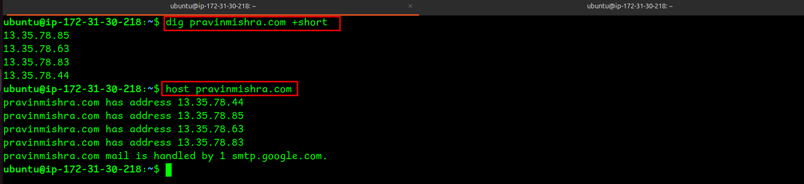

### Step 5: Test Network Connectivity

**Command:**

```bash
ping -c 4 thecloudadvisory.com
```

**What this command does:**

The `ping` command sends network packets to a destination and measures whether it responds. The `-c 4` option limits the test to four packets.

**Why we use it:**

To check whether the EC2 instance can communicate with an external host over the network.

**What to look for:**

- Successful replies from the destination.
- Packet loss percentage.
- Round-trip response times.

**Observation:**

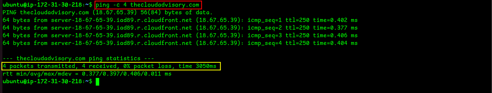


### Step 6: Inspect Listening Ports and Network Services

**Command:**

```bash
sudo ss -tulpen
```

**What this command does:**

The `ss` command displays socket information, including listening ports and active network connections.

**Command options:**

- `-t`: Display TCP sockets.
- `-u`: Display UDP sockets.
- `-l`: Display listening sockets.
- `-p`: Show the processes using the sockets.
- `-e`: Display extended socket information.
- `-n`: Display numerical addresses and port numbers.
- `sudo`: Run with elevated privileges to display process information.

**Why we use it:**

To identify which network ports are open and which services are listening for incoming connections on the EC2 instance.

**What to look for:**

- Port `80`: Nginx HTTP service.
- Port `22`: SSH service.
- The local address showing whether a service listens on `0.0.0.0`, `127.0.0.1`, or another address.
- Any unexpected listening ports.

**Observation:**

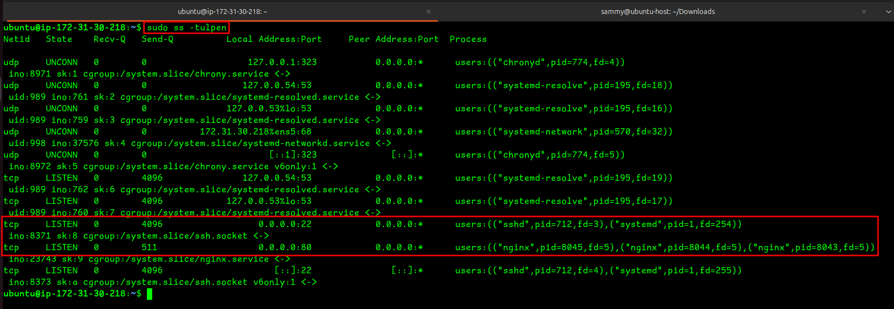

---

### Step 7: Check UFW Firewall Status

**Command:**

```bash
sudo ufw status
```

**What this command does:**

The `ufw` command manages the Uncomplicated Firewall on Ubuntu. The `status` option displays whether the firewall is active and lists its configured rules.

**Why we use it:**

To check the firewall status and identify which incoming connections are allowed or blocked inside ubuntu.

**What to look for:**

- `Status: active` or `Status: inactive`.
- Any configured firewall rules.
- Whether SSH and HTTP traffic are allowed.

**Observation:**

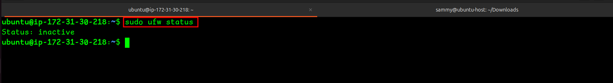

---

## Task 2: Service Health & Systemd Validation (Nginx)

### Step 1: Check Nginx Service Status

**Command:**

```bash
systemctl status nginx --no-pager
```

**What this command does:**

The `systemctl` command communicates with systemd, Ubuntu's service manager. The `status` option displays the current state of the Nginx service. The `--no-pager` option displays the output directly in the terminal.

**Why we use it:**

To verify whether Nginx is running and identify any service failures.

**What to look for:**

- `Active: active (running)`: Nginx is running.
- `Active: inactive (dead)`: Nginx is stopped.
- `Active: failed`: Nginx encountered an error.
- Recent log messages that may explain a failure.

**Observation:**

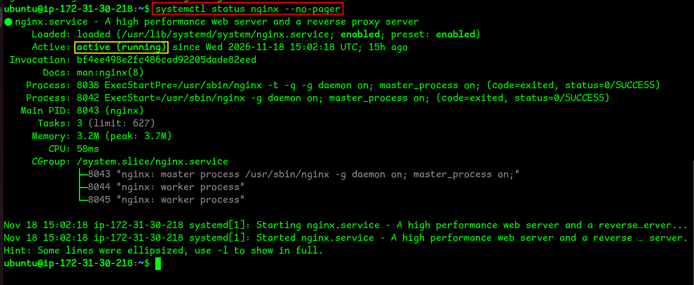

---

### Step 2: Check Nginx Service Enablement

**Command:**

```bash
systemctl is-enabled nginx
```

**What this command does:**

Checks whether the Nginx service is configured to start automatically when Ubuntu boots.

**Why we use it:**

To verify that Nginx will start automatically after a server reboot without requiring manual intervention.

**What to look for:**

- `enabled`: Nginx starts automatically at boot.
- `disabled`: Nginx does not start automatically at boot.
- `static`: Nginx cannot be enabled directly because it is intended to be started by another systemd unit.

**Observation:**

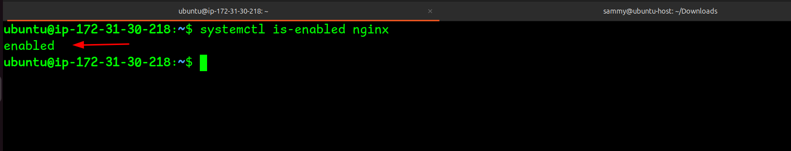

---

### Step 3: Test Nginx Configuration

**Command:**

```bash
sudo nginx -t
```

**What this command does:**

Checks the Nginx configuration files for syntax errors and verifies that the configuration can be loaded successfully.

**Why we use it:**

To ensure that Nginx has a valid configuration before restarting or reloading the service.

**What to look for:**

- `syntax is ok`: No syntax errors were detected.
- `test is successful`: The configuration test passed.
- Error messages: Identify the configuration file and line containing the problem.

**Observation:**

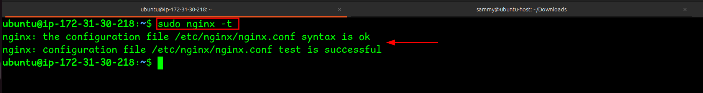

---

### Step 4: Inspect Nginx Processes

**Command:**

```bash
ps aux | grep -E "nginx: master|nginx: worker" | grep -v grep
```

**What this command does:**

Displays the running Nginx master and worker processes.

Understanding the command:


**Why we use it:**

To verify that Nginx processes are running and understand how the service manages incoming web requests.

**What to look for:**

- `nginx: master process`: The main Nginx process that manages the workers.
- `nginx: worker process`: Worker processes that handle client requests.
- Whether the expected processes appear in the output.

**Observation:**

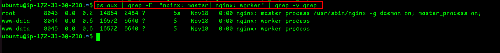

---
### Step 5: Check Which Process Is Listening on Port 80

**Command:**

```bash
sudo ss -lptn '( sport = :80 )'
```

**What this command does:**

The `ss` command displays network socket information. In this command, it shows which process is listening for incoming TCP connections on port 80.

**Understanding the command:**

- `sudo`: Runs the command with administrator privileges.
- `ss`: Displays network socket information.
- `-l`: Shows listening sockets.
- `-p`: Displays the process using the socket.
- `-t`: Shows TCP sockets.
- `-n`: Displays numerical port numbers.
- `( sport = :80 )`: Filters the results to show sockets using port 80.

**Why we use it:**

To confirm that Nginx is listening on port 80 and identify the process responsible for handling HTTP connections.

**What to look for:**

- `LISTEN`: Indicates that a service is waiting for incoming connections.
- `:80`: Identifies the HTTP port.
- `nginx`: Identifies Nginx as the process listening on the port.

**Observation:**

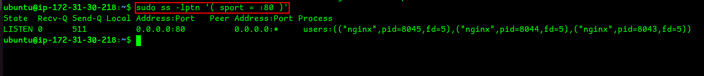

---

### Step 6: Restart the Nginx Service

**Command:**

```bash
sudo systemctl restart nginx
```

**What this command does:**

The `systemctl restart` command stops the Nginx service and starts it again.

**Why we use it:**

To restart Nginx and ensure that the service starts correctly after any configuration or service changes.

**What to look for:**

- No error messages after running the command.
- The command returns to the terminal prompt.
- We will verify that Nginx is running in the next step.

**Observation:**

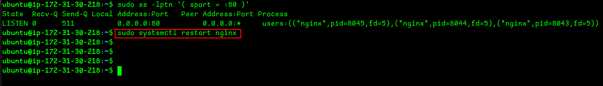

---

### Task 3: Logs & Request Trace

**Goal:**

Verify real traffic flow and analyze logs to understand system behaviour and identify errors.

In production, confirming that an application is working is not enough. Logs help us verify incoming requests, inspect responses, and identify problems.

#### Step 1: Generate Traffic

**Command:**

```bash
curl -s http://<public-ip> > /dev/null
```

**What this command does:**

The `curl` command sends an HTTP request to the application using its public IP address.

**Understanding the command:**

- `curl`: Sends a request to a web server.
- `-s`: Runs silently without displaying progress information.
- `http://<public-ip>`: The public IP address of the EC2 instance hosting the application.
- `> /dev/null`: Discards the response body instead of displaying it in the terminal.

**Why we use it:**

To generate a request to the application. Nginx should record this request in its access log.

**What to look for:**

- The command should return to the terminal prompt.
- No connection error should appear.

**Observation:**

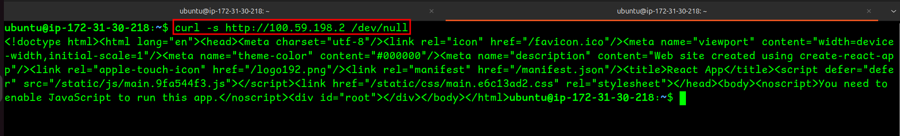

---

#### Step 2: Check Response Status

**Command:**

```bash
curl -I http://<public-ip> > /dev/null
```

**What this command does:**

The `curl` command sends an HTTP request to the application. The `-I` option requests only the HTTP response headers instead of the full page content.

**Understanding the command:**

- `curl`: Sends a request to the web server.
- `-I`: Requests the response headers.
- `http://<public-ip>`: The public IP address of the EC2 instance.
- `> /dev/null`: Discards the command's output.

**Why we use it:**

To check the HTTP response from the web server without downloading the full application page.

**What to look for:**

The command as written discards the response headers, so it will not display the HTTP status code. To inspect the status code in your terminal, use this additional diagnostic command:

```bash
curl -I http://<public-ip>
```

Look for a status such as:

- `200 OK`: The request was successful.
- `301` or `302`: The server redirected the request.
- `403 Forbidden`: The server refused access.
- `404 Not Found`: The requested resource was not found.
- `500` or `502`: A server-side problem occurred.

**Observation:**

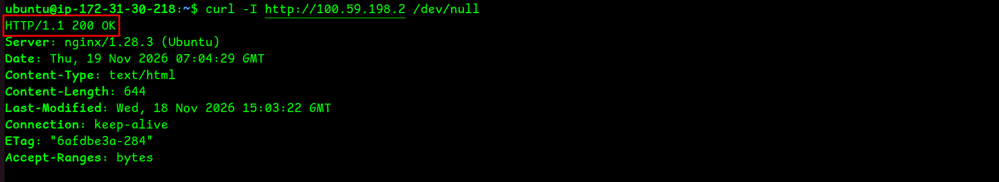

---

#### Step 3: Check Nginx Access Logs

**Command:**

```bash
sudo tail -n 30 /var/log/nginx/access.log
```

**What this command does:**

This command displays the most recent 30 lines from the Nginx access log.

The access log records HTTP requests received by the Nginx web server.

**Understanding the command:**

- `sudo`: Runs the command with administrator privileges.
- `tail`: Displays the end of a file.
- `-n 30`: Displays the last 30 lines.
- `/var/log/nginx/access.log`: The location of the Nginx access log file.

**Why we use it:**

To confirm that requests are reaching Nginx and inspect how the server responds to them.

**What to look for:**

- The IP address of the client making the request.
- The requested resource, such as `/`.
- The HTTP response status code, such as `200`.
- The request method, such as `GET`.
- The response size and request details.

**Observation:**

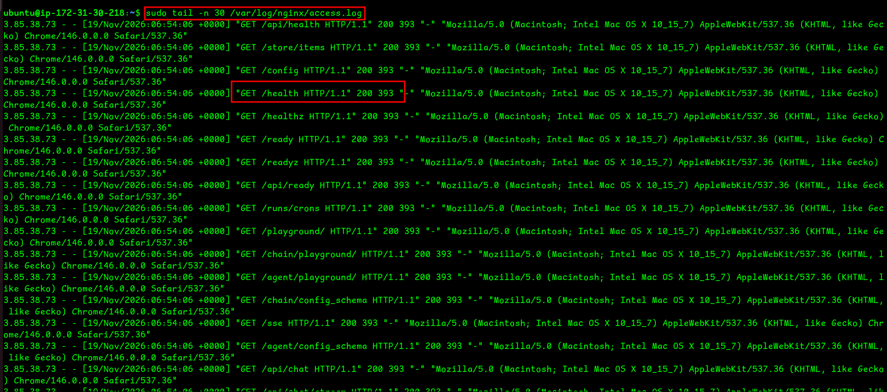

---

#### Step 4: Check Nginx Error Logs

**Command:**

```bash
sudo tail -n 30 /var/log/nginx/error.log
```

**What this command does:**

This command displays the most recent 30 lines from the Nginx error log.

The error log records problems and warnings reported by the Nginx web server.

**Understanding the command:**

- `sudo`: Runs the command with administrator privileges.
- `tail`: Displays the end of a file.
- `-n 30`: Displays the last 30 lines.
- `/var/log/nginx/error.log`: The location of the Nginx error log file.

**Why we use it:**

To investigate whether Nginx has encountered errors that could affect the application or its ability to serve requests.

**What to look for:**

- Error messages related to failed requests.
- Configuration problems.
- Permission errors.
- Connection failures.
- File or resource access problems.

If the command produces no output, the error log may currently be empty.

**Observation:**

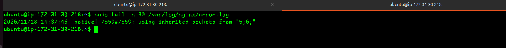

---
#### Step 5: Check Nginx System Logs

**Command:**

```bash
sudo journalctl -u nginx --no-pager -n 50
```

**What this command does:**

This command displays the 50 most recent system log entries related to the Nginx service.

System logs help us understand what happened to a service, including when it started, stopped, restarted, or encountered errors.

**Understanding the command:**

- `sudo`: Runs the command with administrator privileges.
- `journalctl`: Displays logs collected by the systemd journal.
- `-u nginx`: Filters the logs to show entries related to the Nginx service.
- `--no-pager`: Displays the output directly in the terminal.
- `-n 50`: Shows the 50 most recent log entries.

**Why we use it:**

To investigate Nginx service activity and identify events that may explain service failures or unexpected behaviour.

**What to look for:**

- Nginx starting successfully.
- Nginx stopping or restarting.
- Configuration-related errors.
- Failed service start attempts.
- Other warnings or error messages.

**Observation:**

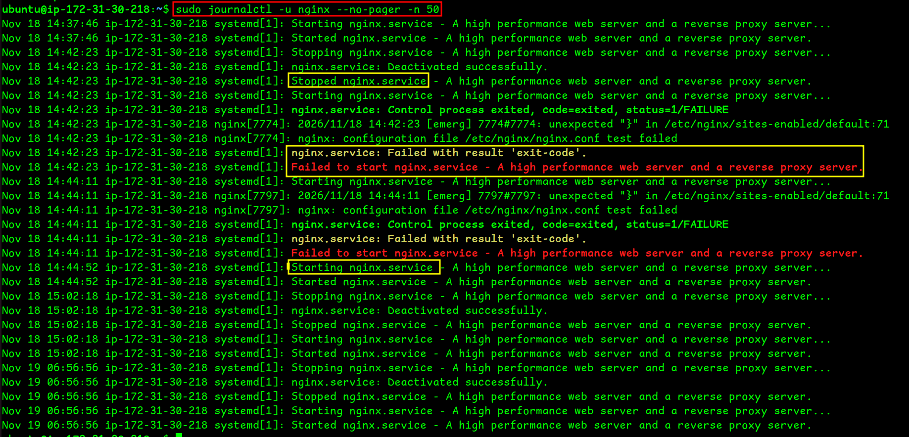

---

### Task 4: System Resource Health Check (Capacity Red Flags)

**Goal:**

Assess server capacity and detect potential performance or failure risks.

In simple terms: Can this server handle traffic, or is it running out of resources?

#### Step 1: Check Server Uptime

**Command:**

```bash
uptime
```

**What this command does:**

The `uptime` command displays how long the server has been running since it was last started.

It also provides information about the number of logged-in users and the system load.

**Why we use it:**

To understand how long the server has been running and get an initial indication of its workload.

**What to look for:**

- **Current time:** The server's current time.
- **Up:** How long the server has been running.
- **Users:** Number of users currently logged in.
- **Load average:** The average system load over the last 1, 5, and 15 minutes.

**Observation:**

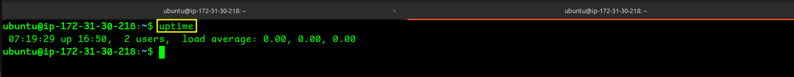

---

#### Step 2: Check Memory Usage

**Command:**

```bash id="d10g7z"
free -h
```

**What this command does:**

The `free` command displays information about the server's memory usage.

Memory (RAM) is the temporary storage the server uses while running applications and services.

**Understanding the command:**

- `free`: Displays memory usage information.
- `-h`: Displays memory values in a human-readable format, such as MB and GB.

**Why we use it:**

To check how much memory is available and determine whether the server is running low on RAM.

**What to look for:**

- **Total:** The total amount of RAM available to the server.
- **Used:** The amount of RAM currently in use.
- **Free:** The amount of completely unused RAM.
- **Available:** An estimate of how much memory can be used by applications without swapping.

**Observation:**

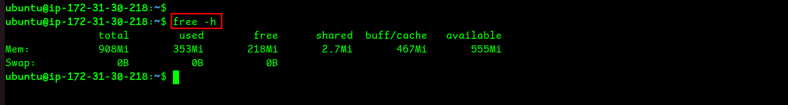

---

#### Step 3: Check Disk Usage

**Command:**

```bash id="d9qls1"
df -h
```

**What this command does:**

The `df` command displays information about disk space usage on the server.

Disk space is where the operating system, application files, logs, and other data are stored.

**Understanding the command:**

- `df`: Displays available and used disk space.
- `-h`: Displays disk sizes in a human-readable format, such as MB and GB.

**Why we use it:**

To check whether the server has enough storage space and identify filesystems that are getting full.

**What to look for:**

- **Filesystem:** The storage device or filesystem.
- **Size:** Total storage capacity.
- **Used:** Storage space currently occupied.
- **Avail:** Remaining available storage.
- **Use%:** Percentage of storage currently used.
- **Mounted on:** The directory where the filesystem is accessible.

**Observation:**

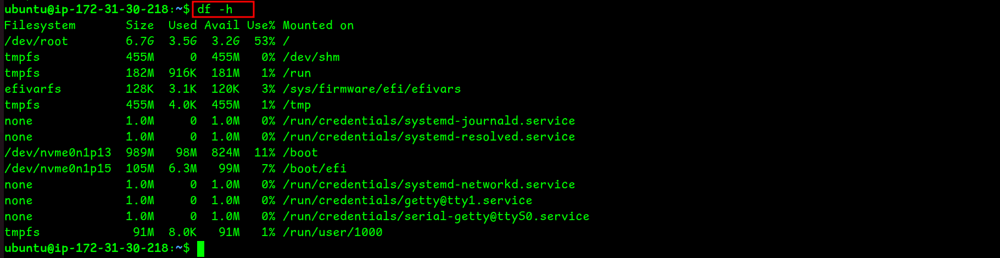

---

#### Step 4: Identify Large Directories Inside `/var`

**Command:**

```bash id="s0ax3h"
sudo du -sh /var/* | sort -h
```

**What this command does:**

This command checks the disk space used by directories and files inside `/var`, then sorts the results from smallest to largest.

The `/var` directory stores data that changes while the system is running, such as application logs, caches, and service data.

**Understanding the command:**

- `sudo`: Runs the command with administrator privileges.
- `du`: Estimates the disk space used by files and directories.
- `-s`: Displays a summary for each item instead of listing every file.
- `-h`: Displays sizes in a human-readable format, such as KB, MB, and GB.
- `/var/*`: Checks the items directly inside the `/var` directory.
- `|`: Passes the output of one command to another.
- `sort -h`: Sorts the reported sizes from smallest to largest, using human-readable size values.

**Why we use it:**

To identify which directories inside `/var` consume the most disk space and detect potential storage problems.

**What to look for:**

- Directories using unusually large amounts of disk space.
- `/var/log`: Stores system and application logs.
- `/var/cache`: Stores cached data.
- `/var/lib`: Stores data used by installed services and applications.

**Observation:**

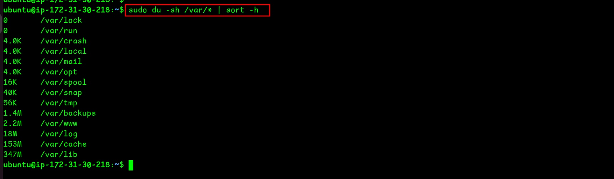

---

### Task 5: Configuration & Deployment Verification

**Goal:**

Ensure the correct React build is deployed and Nginx is serving it properly.

In simple terms: Are we serving the correct frontend version through Nginx?

#### Step 1: Web Root File Check

**Command:**

```bash
ls -lah /var/www/html | head -n 20
```

**What this command does:**

This command displays the first 20 entries inside the Nginx web root directory.

The `/var/www/html` directory is the default location where Nginx serves website files.

**Understanding the command:**

- `ls`: Lists files and directories.
- `-l`: Displays detailed information, including permissions, ownership, file size, and modification date.
- `-a`: Includes hidden files.
- `-h`: Displays file sizes in a human-readable format.
- `/var/www/html`: The directory being inspected.
- `|`: Passes the output to another command.
- `head -n 20`: Displays only the first 20 lines.

**Why we use it:**

To verify that the deployed React application files are present in the Nginx web root.

**What to look for:**

- `index.html`: The main HTML file served by the web server.
- JavaScript and CSS assets.
- Other application files and directories.
- File sizes and modification dates.

**Observation:**

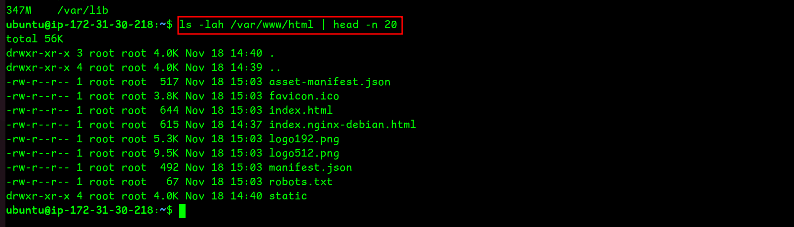

---

#### Step 2: Deployment Verification (Your Name Check)

**Command:**

```bash id="zj2l5c"
grep -R "Deployed by" -n /var/www/html 2>/dev/null | head
```

**What this command does:**

This command searches the deployed application files for the text `Deployed by`.

We use it to check whether the deployment contains the expected author information.

**Understanding the command:**

- `grep`: Searches files for specific text.
- `-R`: Searches recursively through files and subdirectories.
- `"Deployed by"`: The exact text being searched for.
- `/var/www/html`: The directory being searched.
- `2>/dev/null`: Hides error messages, such as permission or file-access errors.
- `|`: Passes the search results to another command.
- `head`: Displays the beginning of the results.
- `-n`: Specifies how many lines to display.

**Why we use it:**

To verify whether the deployed frontend contains the expected `Deployed by` text and confirm the deployment identification.

**What to look for:**

- A matching line containing `Deployed by`.
- Your name appearing in the matching text.
- No output may mean the text was not found in the searched files.

**Observation:**

_To be completed after inspecting the actual command output._

---

### Step 3: Verify the Nginx Configuration

**Command:**

```bash
grep -n "try_files" /etc/nginx/sites-available/default
```

**What this command does:**

- `grep`: Searches for specific text in a file.
- `-n`: Displays the line number where the matching text is found.
- `"try_files"`: Specifies the configuration directive we want to find.
- `/etc/nginx/sites-available/default`: The path to the Nginx default site configuration file.

**Why we use it:**

To check how Nginx handles requests for files that do not exist.

For a React application, the `try_files` directive is commonly configured to serve `index.html` when a requested route does not match an existing file. This allows React Router to handle application routes.

**What to look for:**

A result similar to:

```nginx
try_files $uri $uri/ /index.html;
```

**Observation:**

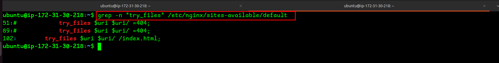

---

### Step 1: Introduce a Configuration Error

**Command:**

```bash
sudo nano /etc/nginx/sites-available/default
```

**What this command does:**

Opens the Nginx default site configuration file using the Nano text editor.

**Action:**

1. Locate the following line:

   ```nginx
   try_files $uri /index.html;
   ```

2. Remove the semicolon (`;`) at the end so that it becomes:

   ```nginx
   try_files $uri /index.html
   ```

3. Save the file and exit Nano.

   - `Ctrl + O`: Save the file.
   - `Enter`: Confirm the filename.
   - `Ctrl + X`: Exit Nano.

**Validate the Configuration Error:**

After saving the file, run:

```bash
sudo nginx -t
```

**Expected Result:**

Nginx should report a configuration syntax error because the semicolon has been removed.

You should see an error message indicating that the configuration test failed. The exact error message and line number may vary.

**Why we do this:**

To simulate a real-world Nginx configuration mistake and observe how Nginx detects invalid configuration syntax before a restart.

**Observation:**

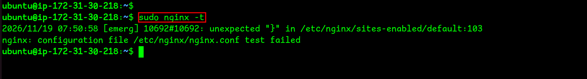

---

### Step 2: Fix the Nginx Configuration

**Command:**

```bash
sudo nano /etc/nginx/sites-available/default
```

**What this command does:**

Opens the Nginx default site configuration file in the Nano text editor so that we can correct the error.

**Action:**

1. Locate the line we modified in Step 1:

   ```nginx
   try_files $uri /index.html
   ```

2. Add the missing semicolon (`;`) at the end so that it becomes:

   ```nginx
   try_files $uri /index.html;
   ```

3. Save the file and exit Nano.

   - `Ctrl + O`: Save the file.
   - `Enter`: Confirm the filename.
   - `Ctrl + X`: Exit Nano.

**Expected Result:**

The missing semicolon has been restored, correcting the configuration syntax error.

**Observation:**

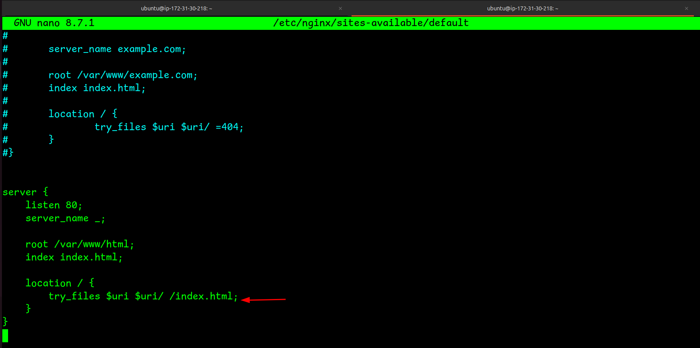

---

### Step 3: Validate the Corrected Nginx Configuration

**Command:**

```bash
sudo nginx -t
```

**What this command does:**

Tests the Nginx configuration files for syntax errors and checks whether the configuration can be loaded successfully.

**Why we use it:**

To confirm that the missing semicolon has been restored and that the configuration is now valid before restarting Nginx.

**Expected Result:**

You should see output similar to:

```text
nginx: the configuration file /etc/nginx/nginx.conf syntax is ok
nginx: configuration file /etc/nginx/nginx.conf test is successful
```

This confirms that Nginx can successfully read the corrected configuration.

**Observation:**

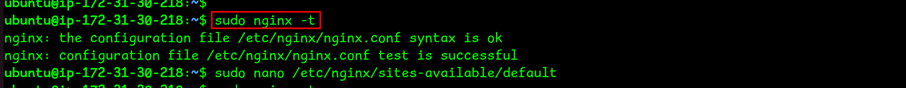

---

### Step 4: Restart the Nginx Service

**Command:**

```bash
sudo systemctl restart nginx
```

**What this command does:**

Restarts the Nginx service by stopping it and starting it again.

**Why we use it:**

To ensure that Nginx starts successfully with the corrected configuration and resumes serving requests.

**Expected Result:**

- No error messages should appear.
- The terminal should return to the command prompt.
- Nginx should start successfully.

**Observation:**

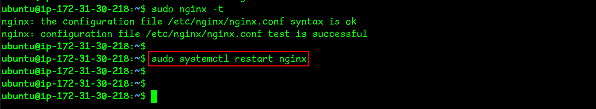

---

### Step 5: Confirm Application Recovery

**Command:**

```bash
curl -I http://<public-ip>
```

Replace `<public-ip>` with the actual public IPv4 address of the EC2 instance.

**What this command does:**

- `curl`: Sends an HTTP request to the application.
- `-I`: Requests the HTTP response headers without downloading the response body.
- `http://<public-ip>`: Specifies the public address of the EC2 instance.

**Why we use it:**

To confirm that Nginx is responding to HTTP requests after the configuration error has been corrected and the service restarted.

**Expected Result:**

You should see a successful HTTP response similar to:

```text
HTTP/1.1 200 OK
Server: nginx
```

The `200 OK` status indicates that the server successfully handled the request.

**Observation:**

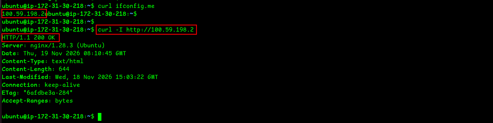

---

## Task 7: Web Application Failure Simulation

### Goal

Simulate missing deployment content and recover the application safely.

### Step 1: Back Up the Deployed Web Application Directory

**Command:**

```bash
sudo mv /var/www/html /var/www/html_backup
```

**What this command does:**

- `sudo`: Runs the command with administrator privileges.
- `mv`: Moves or renames files and directories.
- `/var/www/html`: Specifies the original web application directory.
- `/var/www/html_backup`: Specifies the new backup directory name.

**Why we use it:**

To safely preserve the deployed application files before simulating a failure. This allows us to restore the original application if something goes wrong.

**Verify the Backup and Original Directory:**

After renaming the directory, run:

```bash
ls -ld /var/www/html /var/www/html_backup
```

**What this command does:**

- `ls`: Lists files and directories.
- `-l`: Displays detailed information.
- `-d`: Displays information about the directories themselves rather than their contents.
- `/var/www/html`: Checks whether the original web directory still exists.
- `/var/www/html_backup`: Checks whether the backup directory exists.

**Expected Result:**

- `/var/www/html` should report that no such file or directory exists.
- `/var/www/html_backup` should appear, confirming that the original web directory has been renamed and preserved.

**Why we verify this:**

To confirm that the original deployment directory is no longer in its previous location and that the backup is available before simulating the failure.

**Observation:**

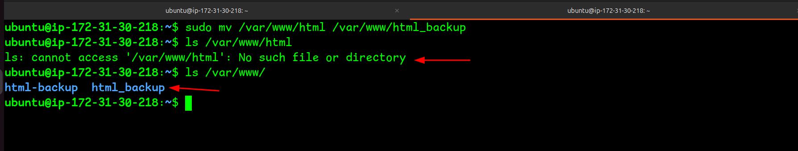

---

### Step 2: Create an Empty Web Directory

**Command:**

```bash
sudo mkdir -p /var/www/html
```

**What this command does:**

- `sudo`: Runs the command with administrator privileges.
- `mkdir`: Creates a new directory.
- `-p`: Creates the directory if it does not exist.
- `/var/www/html`: Specifies the directory to create.

**Why we use it:**

To create an empty web directory with the same name as the original directory. This simulates a situation where the deployed application files are missing.

**Expected Result:**

The `/var/www/html` directory is created successfully but contains no application files. The original application files remain safely stored in `/var/www/html_backup`.

**Verify the Empty Directory:**

Run:

```bash
ls -la /var/www/html
```

**What this command does:**

Lists the contents of the web directory, including hidden files.

**Expected Result:**

You should see only the directory entries `.` and `..`, confirming that the directory is empty.

**Observation:**

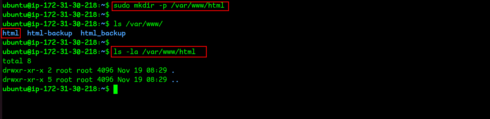

---

### Step 3: Confirm Application Failure

**Command:**

```bash
curl -I http://<public-ip>
```

Replace `<public-ip>` with the public IPv4 address of your EC2 instance.

**What this command does:**

- `curl`: Sends an HTTP request to a server.
- `-I`: Requests only the HTTP response headers.
- `http://<public-ip>`: Specifies the public address of the EC2 instance.

**Why we use it:**

To check how Nginx responds when the original application files are missing from the web directory.

**Expected Result:**

The server may return an HTTP error, such as:

```text
HTTP/1.1 403 Forbidden
```

This can happen because Nginx has no `index.html` file to serve from the empty directory.

The exact response depends on the Nginx configuration.

**Observation:**

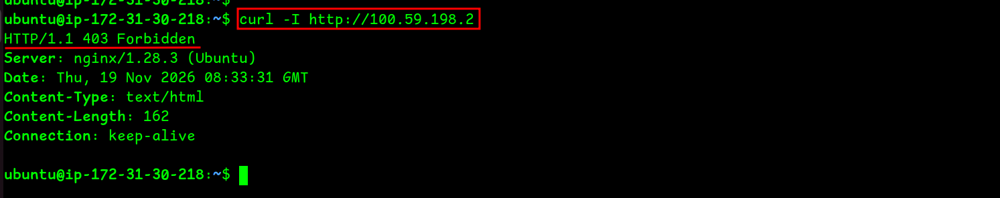

---

### Step 4: Restore the Application from Backup

**Command 1:**

```bash
sudo rm -rf /var/www/html
```

**What this command does:**

- `sudo`: Runs the command with administrator privileges.
- `rm`: Removes files and directories.
- `-r`: Removes directories and their contents recursively.
- `-f`: Forces removal without asking for confirmation.
- `/var/www/html`: Specifies the empty web directory to remove.

**Why we use it:**

To remove the empty directory created during the failure simulation so that we can restore the original application directory.

**Command 2:**

```bash
sudo mv /var/www/html_backup /var/www/html
```

**What this command does:**

Moves the backup directory back to its original location and restores its original name.

**Why we use it:**

To restore the original deployed application files so that Nginx can serve the React application again.

**Expected Result:**

The empty web directory is removed, and the original application files are restored to `/var/www/html`.

**Verify the Restoration:**

Run:

```bash
ls -lah /var/www/html | head -n 20
```

**What this command does:**

Lists the restored web directory contents in a detailed, human-readable format and displays the first 20 entries.

**Expected Result:**

You should see the original application files and directories, including `index.html` and the static assets.

**Observation:**

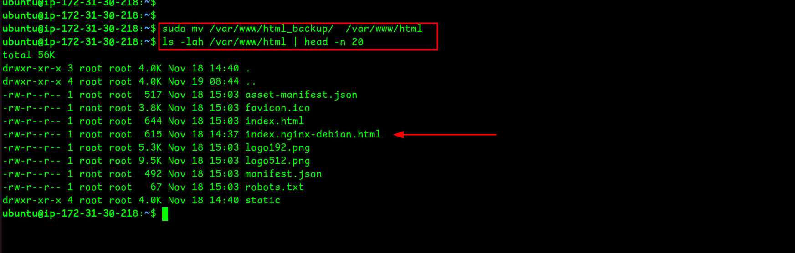

---

### Step 5: Restart the Nginx Service

**Command:**

```bash
sudo systemctl restart nginx
```

**What this command does:**

- `sudo`: Runs the command with administrator privileges.
- `systemctl`: Manages system services on Ubuntu.
- `restart`: Stops the Nginx service and starts it again.
- `nginx`: Specifies the service to restart.

**Why we use it:**

To restart Nginx after restoring the original application files and ensure that the web server continues serving the application correctly.

**Expected Result:**

- No error messages should appear.
- The terminal should return to the command prompt.
- Nginx should restart successfully.

**Observation:**

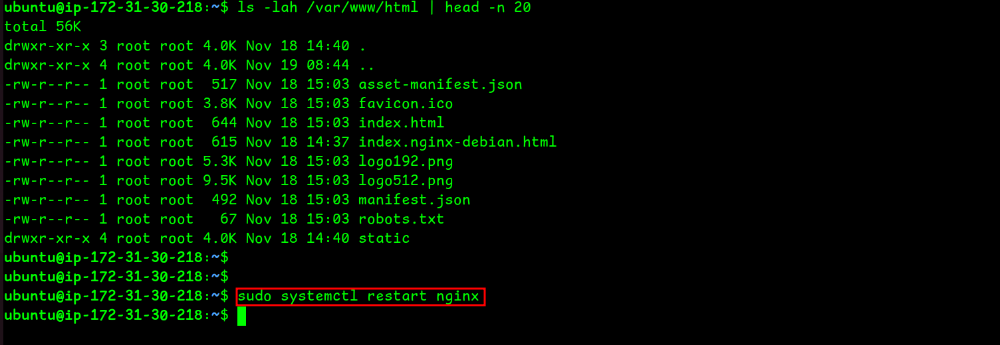

---

### Step 6: Confirm Application Recovery

**Command:**

```bash
curl -I http://<public-ip>
```

Replace `<public-ip>` with the public IPv4 address of your EC2 instance.

**What this command does:**

- `curl`: Sends an HTTP request to the server.
- `-I`: Requests only the HTTP response headers.
- `http://<public-ip>`: Specifies the public address of the EC2 instance.

**Why we use it:**

To confirm that Nginx is responding to HTTP requests and that the application is accessible again after restoring the original deployment files.

**Expected Result:**

You should see a successful HTTP response similar to:

```text
HTTP/1.1 200 OK
Server: nginx
```

The `200 OK` status indicates that the server successfully handled the request.

**Observation:**

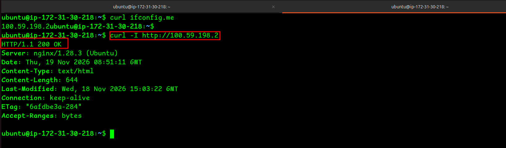

---

## Task 8: Security & Reliability Review

### Goal

Review and reflect on the security and reliability practices applied during the production maintenance drill.

### Step 1: Review Server Security Practices

**Security practices reviewed:**

1. **Firewall protection:** Reviewed the Ubuntu UFW firewall status and the role of AWS Security Groups in controlling network traffic.
2. **Restricted access:** Used SSH access controls to limit who can connect to the EC2 instance.
3. **Least privilege:** Used `sudo` when administrator privileges were required instead of running every command with elevated permissions.
4. **Network exposure:** Reviewed listening ports using `sudo ss -tulpen` to identify services accepting network connections.
5. **Sensitive information:** Avoided exposing passwords, private keys, and other credentials in screenshots and documentation.

**Observation:**

_The server's security posture was reviewed by examining network access, firewall controls, listening services, and administrative privileges._

### Step 2: Review Service Reliability Practices

**Reliability practices reviewed:**

1. **Service monitoring:** Used `systemctl status nginx` to check whether the Nginx service was running.
2. **Configuration validation:** Used `sudo nginx -t` to detect configuration errors before restarting Nginx.
3. **Log monitoring:** Examined Nginx access logs, error logs, and system journal entries to understand server activity and troubleshoot issues.
4. **Resource monitoring:** Used `uptime`, `free -h`, and `df -h` to inspect system load, memory usage, and disk capacity.
5. **Deployment verification:** Inspected the web root directory and Nginx configuration to check the deployed application.
6. **Backup and recovery:** Created a backup of the deployed application directory before simulating missing deployment content.
7. **Failure simulation:** Introduced an intentional Nginx configuration error and simulated missing application files to practise incident recovery.
8. **Recovery verification:** Used HTTP requests with `curl -I` to check whether the application responded after recovery.

**Observation:**

_The maintenance drill demonstrated the importance of monitoring services, validating configurations, keeping backups, and verifying application availability after recovery._

### Step 3: Overall Observations and Lessons Learned

This assignment provided practical experience in performing production maintenance and responding to simulated incidents on an Ubuntu server.

The key lessons learned include:

- Checking server health regularly helps identify potential problems before they affect application availability.
- Reviewing logs helps identify errors and understand what is happening on a server.
- Configuration files should be validated before restarting services.
- Backups provide a safe recovery point when deployment problems occur.
- After resolving an incident, service status and application availability should always be verified.
- Security and reliability require continuous monitoring and proper access controls.

**Final Observation:**

The production maintenance drill demonstrated how a DevOps engineer can inspect, troubleshoot, simulate failures, and recover a web application while protecting the deployed application files.

