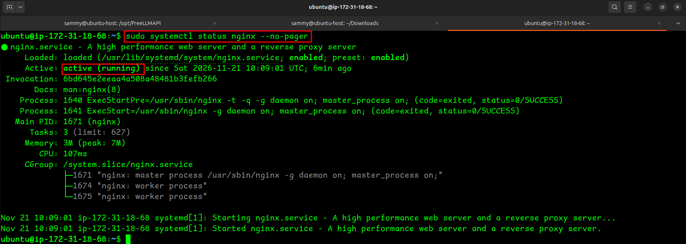
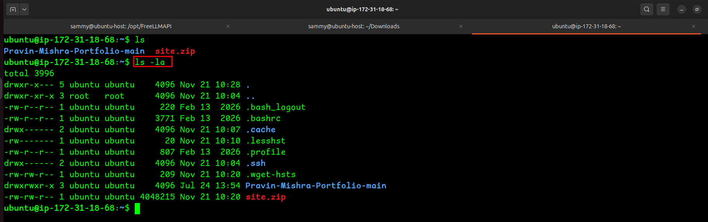
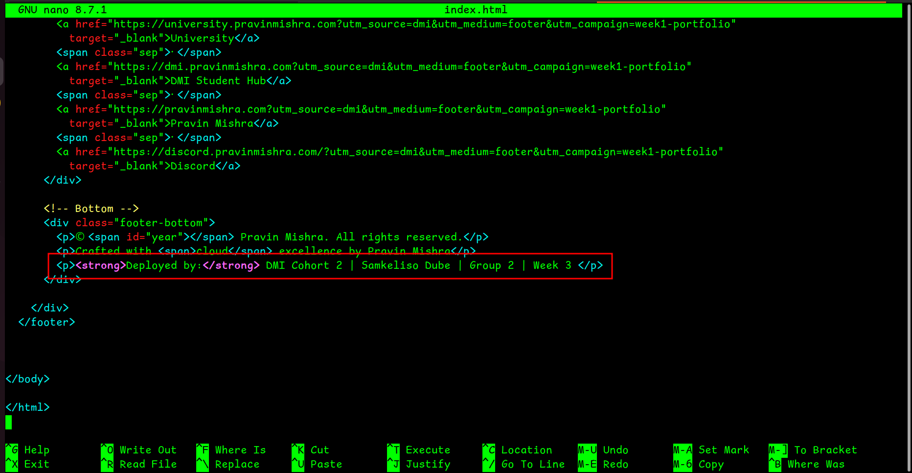
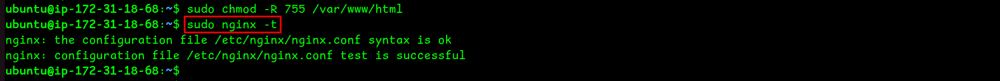
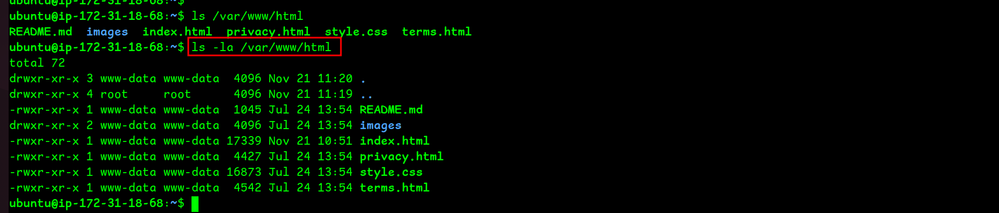
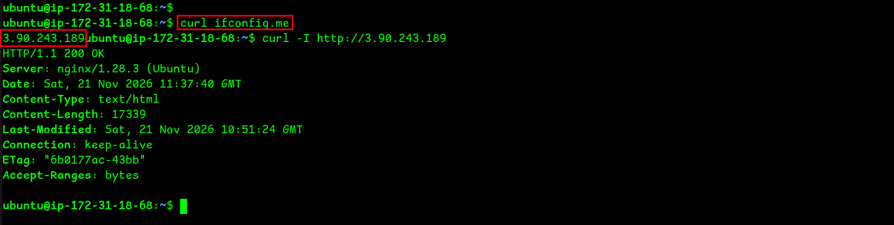
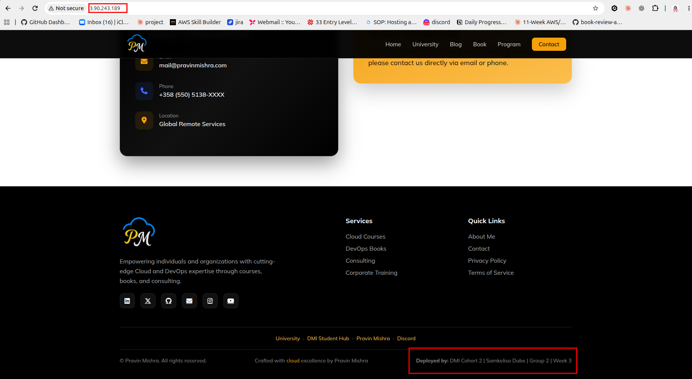
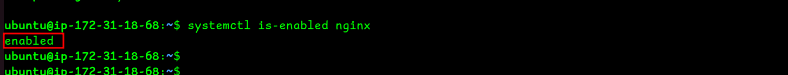
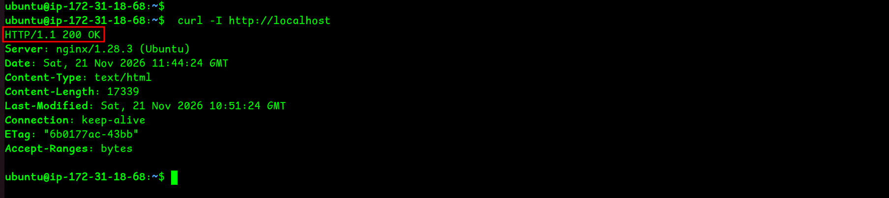

# STANDARD OPERATING PROCEDURE (SOP)
## Assignment 04: Deploy EpicReads Portfolio Website Using Nginx on Ubuntu

**Prepared by:** Samkeliso Dube  
**Programme:** DevOps Micro-Internship - DMI Cohort 2 
**Assignment:** 04  
**Environment:** Ubuntu Linux VM / AWS EC2  
**Web Server:** Nginx  

---

## 1. Introduction

### 1.1 Purpose

This Standard Operating Procedure documents the process of deploying the EpicReads Portfolio Website on an Ubuntu Linux server using Nginx.

The procedure covers checking the Nginx service, obtaining the website source code, making the required ownership changes, deploying the website files, and verifying that the website is publicly accessible.

### 1.2 Expected Outcome

At the end of this deployment, the EpicReads Portfolio Website should:

- Be served by Nginx on the Ubuntu server.
- Be accessible through the server's public IP address.
- Display the required ownership information in the website footer.
- Return a successful HTTP response.
- Have Nginx configured to start automatically when the server boots.

### 1.3 Deployment Architecture

The deployment follows this request flow:

---

## 2. Tools and Requirements

### 2.1 Infrastructure Requirements

- Ubuntu Linux virtual machine or AWS EC2 instance.
- Public IP address for external access.
- SSH access to the Ubuntu server.
- Nginx web server.

### 2.2 Software and Utilities

| Tool | Purpose |
|---|---|
| Nginx | Serves the portfolio website |
| wget | Downloads the website source code |
| unzip | Extracts the downloaded ZIP archive |
| Nano | Edits the website footer |
| curl | Tests HTTP connectivity |
| systemctl | Manages and checks Nginx |
| grep | Locates and verifies website content |

### 2.3 Network Requirements

For an AWS EC2 deployment, ensure the Security Group allows:

| Protocol | Port | Source | Purpose |
|---|---:|---|---|
| TCP | 22 | Trusted IP address | SSH administration |
| TCP | 80 | 0.0.0.0/0 | Public HTTP access |

Restrict SSH access to trusted addresses rather than exposing it unnecessarily.

---

## 3. Deployment Procedure

### Task 0: Pre-flight Check

**Objective:** Confirm that Nginx is installed and running before deploying the website.

#### Step 1: Check Nginx service status

```bash
sudo systemctl status nginx --no-pager
```

**What this command does:**

- `systemctl` communicates with systemd.
- `status` displays the current state of the service.
- `nginx` specifies the service being inspected.
- `--no-pager` displays the output directly in the terminal.

**Expected Result:**

The service should display:

```text
Active: active (running)
```

If Nginx is not installed, install it:

```bash
sudo apt update
sudo apt install nginx -y
```

Start and enable the service:

```bash
sudo systemctl enable --now nginx
```

**Why we use this:**

Nginx must be running to serve the website. Enabling the service ensures it starts automatically after a system reboot.

**Evidence Required:**



---

### Task 1: Get Website Source Code

**Objective:** Download and extract the provided portfolio website template.

#### Step 1: Download the website source code

```bash
wget https://github.com/pravinmishraaws/Pravin-Mishra-Portfolio-Template/archive/refs/heads/main.zip -O site.zip
```

**What this command does:**

- `wget` downloads files from the internet.
- The GitHub URL points to the portfolio template.
- `-O site.zip` saves the downloaded archive with the filename `site.zip`.

**Expected Result:**

The ZIP archive should download successfully.

#### Step 2: Install unzip if necessary

```bash
sudo apt install unzip -y
```

This installs the utility required to extract ZIP archives.

#### Step 3: Extract the archive

```bash
unzip site.zip
```

This extracts the website source code into its project directory.

#### Step 4: Inspect the extracted files

```bash
ls -la
```

**What this command does:**

Displays files and directories, including hidden files, in the current directory.

**Expected Result:**

The extracted project directory should be visible:


```text
Pravin-Mishra-Portfolio-main
```

**Evidence Required:**

The following screenshot confirms that the website source code
was successfully extracted into the working directory.



---

### Task 2: Add Ownership Proof (Anti-Copy Change)

**Objective:** Personalise the website footer with the required ownership information.

This step demonstrates that the website deployment has been customised by the person completing the assignment.

#### Step 1: Enter the extracted project directory

```bash
cd Pravin-Mishra-Portfolio-main
```

#### Step 2: Locate the footer content

```bash
grep -rl "Crafted with" .
```

**What this command does:**

- `grep` searches for matching text.
- `-r` searches recursively through directories.
- `-l` displays filenames containing the matching text.
- `"Crafted with"` identifies the existing footer text.
- `.` represents the current directory.

Use the returned filename to identify the HTML file containing the footer.

#### Step 3: Open the HTML file

For example, if the file is `index.html`:

```bash
nano index.html
```

Locate the existing footer and replace or update it with the required ownership information.

Example:

```html
<p>
  <strong>Deployed by:</strong>
  DMI Cohort 3 | Your Full Name | Your Group | Week 3 | DD-MM-YYYY
</p>
```

Replace the placeholders with your actual details.

Save the file in Nano:

- Press `Ctrl + O` to write the changes.
- Press `Enter` to confirm.
- Press `Ctrl + X` to exit.

#### Step 4: Verify the ownership information

```bash
grep -n "Deployed by" index.html
```

**Expected Result:**

The updated footer text should appear in the terminal.

**Evidence Required:**

The screenshot below provides evidence that the website footer
was updated with my personal ownership details using the Nano
text editor.



---

### Task 3: Deploy Website via Nginx

**Objective:** Copy the customised website files into Nginx's default document root.

#### Step 1: Inspect the current Nginx web root

```bash
ls -la /var/www/html
```

**Why we inspect first:**

The web root may already contain an existing website or default Nginx page. Inspecting it helps prevent accidental loss of existing files.

#### Step 2: Back up existing web root content if present

If the directory contains files that must be preserved:

```bash
sudo cp -a /var/www/html "/var/www/html_backup
```

**What this command does:**

- `sudo` provides the required administrative permissions.
- `cp` copies files and directories.
- `-a` preserves file attributes and directory structure.

#### Step 3: Copy the website files into the Nginx web root

Create the Nginx web root directory

```bash
sudo mkdir -p /var/www/html
```

> Note the web-root was renamed to backup so the default html is not there hence why we create another folder

From the extracted project directory:

```bash
sudo cp -a ~/Pravin-Mishra-Portfolio-main/* /var/www/html/
```

**What this command does:**

Copies the website files into `/var/www/html/`


#### Step 4: Set ownership

```bash
sudo chown -R www-data:www-data /var/www/html
```

**Why we use this:**

Nginx commonly runs under the `www-data` account on Ubuntu. Assigning ownership to this account provides consistent ownership of the deployed web content.

#### Step 5: Set appropriate permissions

Set directory permissions:

```bash
sudo chmod -R 755 /var/www/html
```

Why we use this:

Nginx needs sufficient permissions to access and serve the website files.

> Note: For more precise permission management, production environments should generally use 755 for directories and 644 for regular files rather than applying 755 recursively to everything


#### Step 6: Validate Nginx configuration

```bash
sudo nginx -t
```

**Expected Result:**

```text
syntax is ok
test is successful
```

This checks the Nginx configuration before applying changes.

#### Step 7: Reload Nginx

```bash
sudo systemctl reload nginx
```

Reloading allows Nginx to apply configuration changes without unnecessarily stopping the service.

#### Step 8: Verify deployed files

```bash
ls -la /var/www/html
```

**Expected Result:**

The deployed portfolio website files should be visible in the Nginx web root.

**Evidence Required:**


The screenshot below confirms that the Nginx configuration passed
the syntax validation test before reloading the service.




The screenshot below confirms that the portfolio website files
were successfully copied into the Nginx document root.



---

### Task 4: Verify Website is Live

**Objective:** Confirm that the website is accessible through the server's public IP address.

#### Step 1: Identify the public IP address

Run:

```bash
curl -4 ifconfig.me
```

**What this command does:**

Queries an external service to display the public IPv4 address used for outbound internet traffic.

**Important:**

On some cloud networks, the outbound IP may differ from the EC2 instance's assigned public IPv4 address. Confirm the actual instance public IPv4 address in the AWS EC2 console before using it for the browser test.

#### Step 2: Confirm HTTP access is allowed

For AWS EC2, inspect the attached Security Group and confirm that inbound TCP port 80 is allowed.

#### Step 3: Open the website in a browser

Navigate to:

```text
http://YOUR_PUBLIC_IP
```

Replace `YOUR_PUBLIC_IP` with the actual public IPv4 address of the server.

#### Step 4: Verify the ownership footer

Confirm that:

- The portfolio website loads successfully.
- The expected website content is displayed.
- Your full name is visible in the footer.
- The required cohort, group, week and date information is present.

**Evidence Required:**

The screenshot below shows the public IPv4 address returned
by an external IP-checking service.



The screenshot below confirms that the portfolio website is
accessible through the EC2 public IPv4 address and displays
the personalised ownership footer.



---

### Task 5: Mini Real DevOps Operational Check

**Objective:** Perform basic operational checks to confirm that Nginx is configured correctly and serving HTTP requests.

#### Step 1: Check whether Nginx is enabled at boot

```bash
systemctl is-enabled nginx
```

**Expected Result:**

```text
enabled
```

This confirms that Nginx is configured to start automatically during system boot.

#### Step 2: Validate Nginx configuration

```bash
sudo nginx -t
```

**Expected Result:**

```text
syntax is ok
test is successful
```

#### Step 3: Test local HTTP response

```bash
curl -I http://localhost
```

**What this command does:**

- `curl` sends an HTTP request.
- `-I` requests response headers only.
- `localhost` targets the local Ubuntu server.

**Expected Result:**

The response should contain:

```text
HTTP/1.1 200 OK
```

This indicates that the local web server is responding successfully to the HTTP request.

**Evidence Required:**

The screenshot below confirms that Nginx is enabled to start
automatically during system boot.




The screenshot below confirms that Nginx successfully responds
to a local HTTP request with an HTTP 200 OK status code.



---

## 4. Troubleshooting

### 4.1 Nginx is not running

Inspect the service:

```bash
sudo systemctl status nginx --no-pager
```

Inspect recent logs:

```bash
sudo journalctl -u nginx -n 50 --no-pager
```

If appropriate, start the service:

```bash
sudo systemctl start nginx
```

Verify the service status again.

### 4.2 Default Nginx Welcome Page Appears

Inspect the deployed files:

```bash
ls -la /var/www/html
```

Confirm that the website's `index.html` is present in the document root and that Nginx is serving the expected directory.

### 4.3 Website Returns 403 Forbidden

Inspect permissions:

```bash
namei -l /var/www/html/index.html
```

Check that the Nginx process can access the file and traverse its parent directories.

Review the Nginx error log:

```bash
sudo tail -n 50 /var/log/nginx/error.log
```

Correct the underlying issue and retest the website.

### 4.4 Website Cannot Be Accessed Publicly

Inspect whether Nginx is listening on port 80:

```bash
sudo ss -tulpn | grep ':80'
```

Check:

- The instance has a public IP address.
- The AWS Security Group permits inbound TCP port 80.
- Nginx is running.
- The correct public IP address is being used.

### 4.5 Nginx Configuration Test Fails

Run:

```bash
sudo nginx -t
```

Inspect the reported configuration file and line number.

Do not reload Nginx until the configuration test succeeds.

---

## 5. Security and Operational Considerations

- Restrict SSH access to trusted IP addresses.
- Avoid exposing private keys, passwords or AWS credentials in screenshots.
- Use appropriate ownership and file permissions.
- Back up existing website content before replacing it.
- Validate Nginx configuration before reloading.
- Use logs to investigate issues rather than making assumptions.
- Verify application availability after every deployment change.

---

## 6. Final Outcome

The deployment is considered successful when the following evidence confirms that:

1. Nginx is running.
2. The website source code has been downloaded and extracted.
3. The required ownership information has been added.
4. The website files have been deployed into `/var/www/html`.
5. The website is accessible through the public IP address.
6. Nginx is enabled at boot.
7. The local HTTP request returns `200 OK`.


