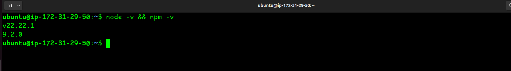
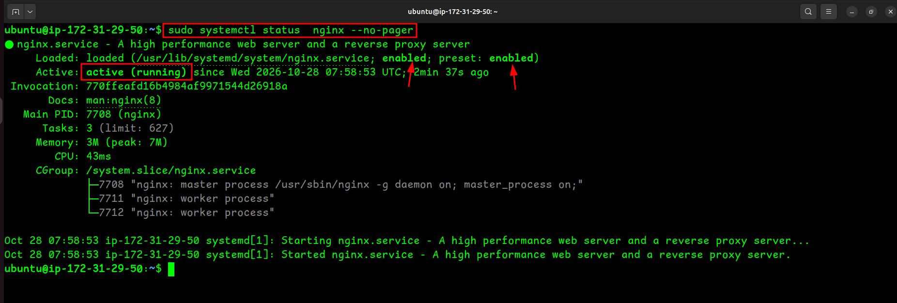
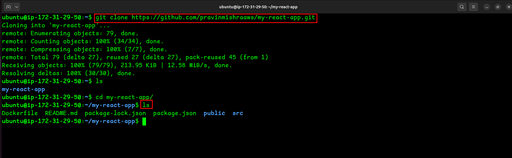
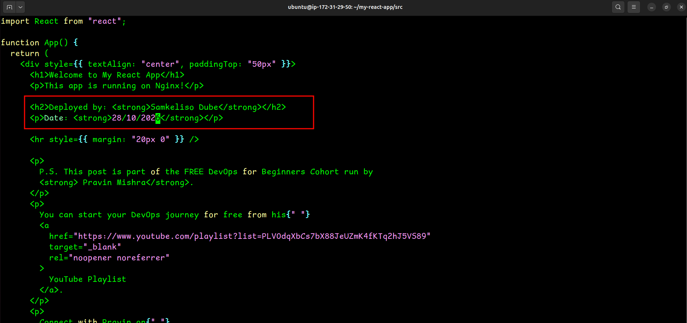
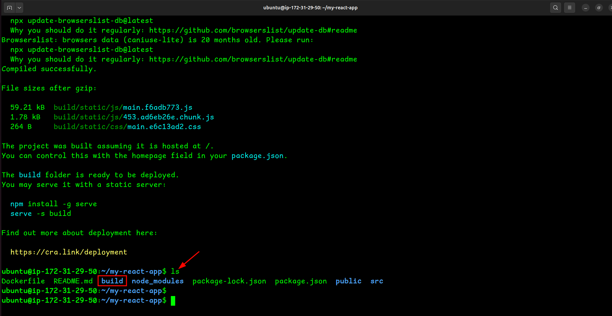
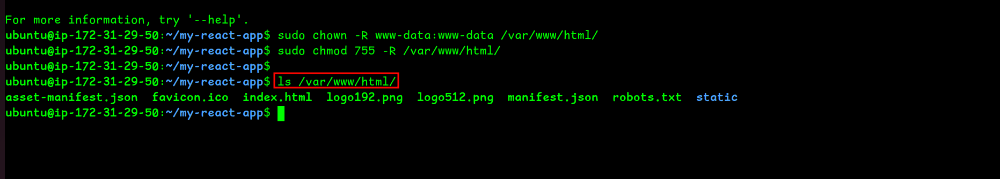
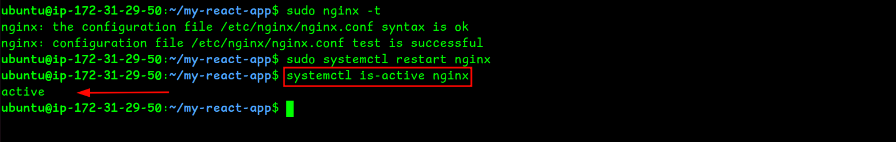
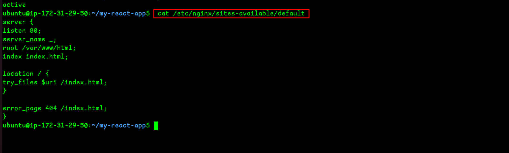
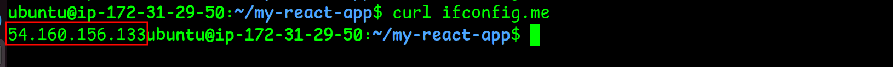
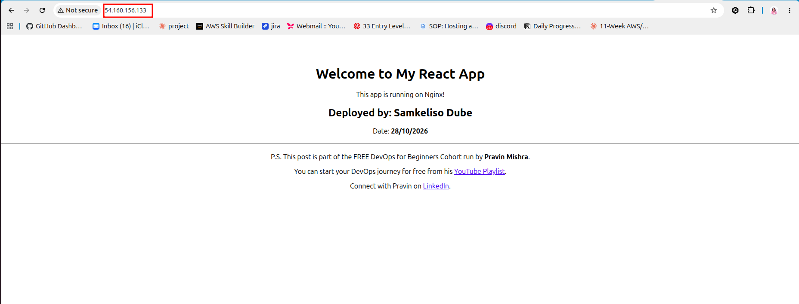

# Assignment 2: Deploy a React App on Ubuntu VM Using Nginx

---

## Purpose

In this assignment, you will deploy a React application on an Ubuntu EC2 instance and serve it using Nginx. You will provision a Linux server, install the required tools, personalize the application with your details, and verify that it is publicly accessible via a browser.

---

# Task 1: Setup Environment (Node.js & npm)

## Goal

Install Node.js and npm on the Ubuntu VM and verify the installation.

## Evidence

**Screenshot 1: Output of `node -v && npm -v` showing installed versions**

---

# Task 2: Setup Environment (Nginx)

## Goal

Install Nginx, start the service, and confirm it is running.

## Evidence

**Screenshot 2: Output of `systemctl status nginx --no-pager` showing Active (running)**

---

# Task 3: Clone React Application

## Goal

Clone the project repository and verify the project files are present.

## Evidence

**Screenshot 3: Output of `ls` inside the `my-react-app` directory showing project files**

---

# Task 4 : Modify Application (Personalization)

## Goal

Update `App.js` with your full name and the current date.

## Evidence

**Screenshot 4 : `nano App.js` open showing your full name and date filled in**

---

# Task 5 : Build React Application

## Goal

Install dependencies and generate the production build.

## Evidence

**Screenshot 5 : Output of `ls` inside `my-react-app` showing the `build/` folder generated**

---

# Task 6 : Deploy React Build to Nginx Web Root

## Goal

Copy the production build files to the Nginx web root directory.

## Evidence

**Screenshot 6 : Output of `ls /var/www/html/` showing the deployed build contents**

---

# Task 7 : Configure Nginx for React Application

## Goal

Apply Nginx configuration for React routing and confirm the service is active.

## Evidence

**Screenshot 7: Output of `systemctl is-active nginx` showing `active`**

**Screenshot 8 : Output of `cat /etc/nginx/sites-available/default` showing the Nginx config**

---

# Task 8 : Test Deployment

## Goal

Verify the React application is publicly accessible via the server's public IP.

## Evidence

**Screenshot 9: Output of `curl ifconfig.me` showing the server's public IP address**

**Screenshot 10 : Browser showing the deployed React app at `http://<public-ip>` with your name and date visible**

---

# LinkedIn Post (Required)

## Evidence

**LinkedIn Post URL**

Paste your LinkedIn post URL here:

`Add your URL here`

**Screenshot : LinkedIn post showing the deployed application**

Add your screenshot here.

---

# Submission Instructions

- Add all required screenshots in your submission.
- Full name must be visible in required screenshots.
- Do not expose sensitive information (keys, passwords, account IDs).

---

# Completion Checklist

- [ ] Node.js and npm installed and verified (Screenshot 1)
- [ ] Nginx installed and running (Screenshot 2)
- [ ] Repository cloned and files verified (Screenshot 3)
- [ ] `App.js` updated with full name and date (Screenshot 4)
- [ ] Production build generated (Screenshot 5)
- [ ] Build files deployed to Nginx web root (Screenshot 6)
- [ ] Nginx configured and active (Screenshots 7 & 8)
- [ ] Public IP retrieved (Screenshot 9)
- [ ] React app accessible in browser with personal details visible (Screenshot 10)
- [ ] LinkedIn post published and URL submitted
- [ ] No sensitive data exposed

---

## 👩🏽‍💻 Personal Reflection

This assignment gave me practical experience deploying a React application on an Ubuntu EC2 instance using Nginx. I learned how to set up the environment, install the required tools, clone the application repository, build the application, and configure Nginx to serve the React application.

Through this hands-on task, I gained a better understanding of how Linux servers and web servers work together to host applications. I also learned the importance of following deployment steps carefully and verifying that the application is accessible through a browser.

## 🎯 Conclusion

This assignment strengthened my understanding of deploying web applications on AWS EC2 using Nginx. It was a valuable opportunity to apply my knowledge practically and build confidence in working with Linux servers and cloud infrastructure.

Going forward, I want to continue practising application deployments and deepen my understanding of the tools and technologies used in DevOps.

---

**Author:** Samkeliso Dube  
**Role:** DevOps Engineer | Cloud Engineer  
**GitHub:** [Samkeliso-Dube](https://github.com/Samkeliso-dube00)  
**LinkedIn:** [Samkeliso Dube](https://www.linkedin.com/in/samkeliso-dube03/)