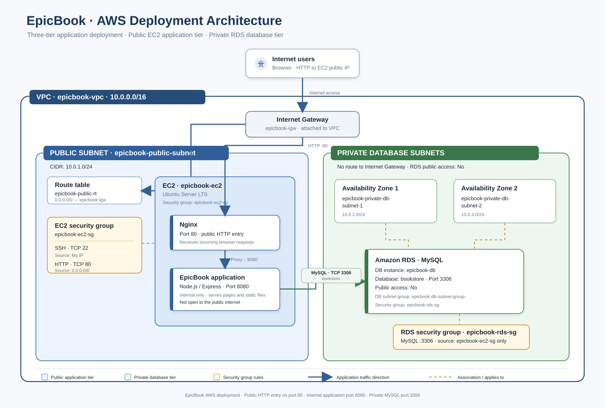

# Assignment 04: Deploy EpicBook on Ubuntu EC2 and MySQL RDS

**Prepared by:** Samkeliso Dube

**Programme:** DevOps Micro Internship (DMI)

**Cohort:** 2

---

## 1. Assignment Overview

### Objective

The objective of this assignment is to deploy the EpicBook application on an Ubuntu EC2 instance and connect it to a MySQL database hosted on Amazon RDS.

The deployment will use a secure AWS network where the application server is publicly accessible, while the database remains in a private subnet.

By completing this assignment, we will practise creating AWS networking resources, configuring security groups, launching an EC2 instance, setting up RDS, deploying an application, and testing communication between the frontend, backend, and database.

### Architecture Overview

The deployment will follow this architecture:



### AWS Resources to Be Created

| Resource | Name | Configuration |
|---|---|---|
| VPC | epicbook-vpc | 10.0.0.0/16 |
| Public subnet | epicbook-public-subnet | 10.0.1.0/24 |
| Private subnet | epicbook-private-subnet | 10.0.2.0/24 |
| Internet Gateway | epicbook-igw | Attached to VPC |
| EC2 security group | epicbook-ec2-sg | SSH, HTTP, HTTPS |
| RDS security group | epicbook-rds-sg | MySQL from EC2 security group only |
| EC2 instance | epicbook-ec2 | Ubuntu 20.04 |
| RDS database | epicbook-rds | MySQL, private access |

**Important:** RDS DB subnet groups normally require subnets in at least two Availability Zones. If AWS does not accept a single private subnet, create a second private subnet in another Availability Zone, using an additional CIDR such as 10.0.3.0/24. This does not require creating a NAT Gateway.

### Tools and Requirements

| Tool | Purpose |
|---|---|
| AWS Management Console | Create and manage AWS resources |
| Ubuntu EC2 | Host the application |
| Amazon RDS MySQL | Host the application database |
| Nginx | Serve the frontend and reverse-proxy API requests |
| Node.js and npm | Run the backend application |
| MySQL client | Connect to and manage the database |
| Git | Clone the application repository |
| SSH client | Connect to the EC2 instance |

---

## 2. Deployment Procedure

---

### Task 1: Create the VPC

**Why are we creating a VPC?**

A Virtual Private Cloud (VPC) provides an isolated network in AWS where we can deploy and manage our cloud resources.

We need a VPC so that the EpicBook EC2 instance and MySQL RDS database can communicate securely within the same AWS network.

#### Step 1: Open the VPC service

1. Sign in to the **AWS Management Console**.

2. In the search bar at the top, type **VPC**.

3. Select **VPC** from the search results.

4. In the **VPC** dashboard, select **Your VPCs** from the left navigation panel.

5. Click **Create VPC**.

#### Step 2: Configure the VPC

Under the **VPC settings**, enter the following:

| Setting | Value |
|---|---|
| Resources to create | VPC only |
| Name tag | epicbook-vpc |
| IPv4 CIDR block | 10.0.0.0/16 |
| IPv6 CIDR block | No IPv6 CIDR block |
| Tenancy | Default |

6. Review the configuration.

7. Click **Create VPC**.

8. Wait for AWS to finish creating the **VPC**.

9. Confirm that epicbook-vpc appears in the **VPC** list.

**Expected result:** The VPC should appear with the CIDR block 10.0.0.0/16 and an available status.

**Screenshot evidence:**

---

### Task 2: Create the Public and Private Subnets

**Why are we creating subnets?**

Subnets divide our VPC into smaller network sections.

We need:

- A public subnet for the Ubuntu EC2 instance, which must be reachable from the internet.

- A private subnet for the MySQL RDS database, which should not be directly accessible from the internet.

#### Step 1: Open the subnet section

1. From the **VPC** dashboard, select **Subnets**.

2. Click **Create subnet**.

3. Under **VPC** ID, select epicbook-vpc.

#### Step 2: Create the public subnet

Enter the following details:

| Setting | Value |
|---|---|
| Subnet name | epicbook-public-subnet |
| Availability Zone | Select an available AZ |
| IPv4 subnet CIDR block | 10.0.1.0/24 |

4. Click **Add new subnet** if you need to add another subnet in the same creation screen.

5. Configure the private subnet using the next table.

#### Step 3: Create the private subnet

| Setting | Value |
|---|---|
| Subnet name | epicbook-private-subnet |
| Availability Zone | Select an available AZ |
| IPv4 subnet CIDR block | 10.0.2.0/24 |

6. Click **Create subnet**.

7. Confirm that both subnets appear in the subnet list.

**Expected result:** Two subnets should be available inside epicbook-vpc.

**Screenshot evidence:** Capture the subnet list showing both subnets and their CIDR blocks.

---

### Task 3: Create and Attach an Internet Gateway

**Why are we creating an Internet Gateway?**

An Internet Gateway allows resources in a public subnet to communicate with the internet when the route table and security group permit that traffic.

Our EC2 instance will need internet access to allow us to connect to it and install the application requirements.

#### Step 1: Create the Internet Gateway

1. In the **VPC** dashboard, select **Internet Gateways**.

2. Click **Create internet gateway**.

3. Enter the following:

| Setting | Value |
|---|---|
| Name tag | epicbook-igw |

4. Click **Create internet gateway**.

#### Step 2: Attach the Internet Gateway to the VPC

5. Select the newly created epicbook-igw.

6. Open **Actions**.

7. Select **Attach to a VPC**.

8. Choose epicbook-vpc.

9. Click **Attach internet gateway**.

**Expected result:** The Internet Gateway should show as attached to epicbook-vpc.

**Screenshot evidence:** Capture the Internet Gateway showing its attached VPC.

---

### Task 4: Configure the Route Table

**Why are we configuring route tables?**

A route table determines where network traffic from a subnet should go.

We need the public subnet to send internet-bound traffic through the Internet Gateway. The private subnet should not have a direct route to the Internet Gateway.

#### Step 1: Open Route Tables

1. In the **VPC** dashboard, select **Route Tables**.

2. Find the route table associated with epicbook-vpc, or create a new route table if necessary.

3. Select the route table intended for the public subnet.

#### Step 2: Add the internet route

4. Open the **Routes** tab.

5. Click **Edit routes**.

6. Click **Add route**.

7. Enter:

| Setting | Value |
|---|---|
| Destination | 0.0.0.0/0 |
| Target | Internet Gateway |
| Internet Gateway | epicbook-igw |

8. Click **Save changes**.

#### Step 3: Associate the public subnet

9. Open the **Subnet associations** tab.

10. Click **Edit subnet associations**.

11. Select epicbook-public-subnet.

12. **Save** the associations.

#### Step 4: Check the private subnet

13. Confirm that epicbook-private-subnet is not associated with the public route table.

14. Do not add a direct Internet Gateway route to the private subnet.

**Expected result:** The public subnet has a route to the Internet Gateway, while the private subnet does not.

**Screenshot evidence:** Capture the public route table and its subnet association.

---

### Task 5: Create the EC2 and RDS Security Groups

**Why are we creating security groups?**

Security groups act as virtual firewalls. They control which network traffic is allowed to reach our AWS resources.

We will create two security groups:

- One for the EC2 application server.

- One for the RDS database.

The database must only accept MySQL traffic from the EC2 security group.

#### Step 1: Create the EC2 security group

1. In the AWS search bar, search for **EC2**.

2. Open the **EC2** dashboard.

3. Under **Network & Security**, select **Security Groups**.

4. Click **Create security group**.

5. Enter:

| Setting | Value |
|---|---|
| Security group name | epicbook-ec2-sg |
| Description | Security group for EpicBook EC2 |
| VPC | epicbook-vpc |

#### Step 2: Configure inbound rules

Add the following inbound rules:

| Type | Port | Source |
|---|---:|---|
| SSH | 22 | My IP |
| HTTP | 80 | 0.0.0.0/0 |
| HTTPS | 443 | 0.0.0.0/0 |

6. Leave outbound traffic at the default setting unless there is a specific reason to restrict it.

7. Click **Create security group**.

#### Step 3: Create the RDS security group

8. Return to **Security Groups**.

9. Click **Create security group**.

10. Enter:

| Setting | Value |
|---|---|
| Security group name | epicbook-rds-sg |
| Description | Security group for EpicBook RDS |
| VPC | epicbook-vpc |

#### Step 4: Configure the RDS inbound rule

11. Add the following inbound rule:

| Type | Port | Source |
|---|---:|---|
| MySQL/Aurora | 3306 | epicbook-ec2-sg |

12. Select the **EC2** security group as the source rather than entering a public IP address.

13. Click **Create security group**.

**Expected result:** EC2 accepts SSH from your IP and web traffic publicly. RDS accepts MySQL traffic only from the EC2 security group.

**Screenshot evidence:** Capture the inbound rules for both security groups.

---

### Task 6: Launch the Ubuntu EC2 Instance

**Why are we launching an EC2 instance?**

Amazon EC2 provides the virtual server that will host our EpicBook application.

We will use Ubuntu as the operating system and place the instance in the public subnet so that we can connect to it using SSH.

#### Step 1: Open the EC2 launch page

1. Open the **EC2** dashboard.

2. Select **Instances**.

3. Click **Launch instances**.

#### Step 2: Configure the instance

Enter the following details:

| Setting | Value |
|---|---|
| Name | epicbook-ec2 |
| AMI | Ubuntu Server 20.04 LTS |
| Instance type | t2.micro or t3.micro |
| Key pair | Create epicbook_key |
| VPC | epicbook-vpc |
| Subnet | epicbook-public-subnet |
| Auto-assign public IP | Enable |
| Security group | epicbook-ec2-sg |

4. Under storage, review the default volume and keep within your budget.

5. Review the configuration.

6. Click **Launch instance**.

#### Step 3: Verify the instance

7. Open **Instances**.

8. Wait until the instance reaches the running state.

9. Confirm that status checks pass.

10. Record the public IPv4 address for SSH access.

**Expected result:** An Ubuntu EC2 instance should be running in the public subnet.

**Screenshot evidence:** Capture the EC2 instance details showing its name, state, and public IPv4 address. Do not expose private key contents.

---

### Task 7: Connect to EC2 and Install the Required Software

**Why are we installing these packages?**

The EC2 instance needs the software required to run and serve the EpicBook application.

| Software | Purpose |
|---|---|
| Node.js | Runs the backend application |
| npm | Installs Node.js dependencies |
| Nginx | Serves the frontend and forwards API requests |
| MySQL client | Connects to the RDS database |
| Git | Downloads the application source code |

#### Step 1: Connect to the EC2 instance

1. In the **EC2** dashboard, select epicbook-ec2.

2. Click **Connect**.

3. Select the **SSH client** tab.

4. Follow the displayed SSH instructions using your downloaded key pair.

```bash
chmod 400 <Your_epicbook_key>
ssh -i <Your_epicbook_key> ubuntu@<Your_public_ip>
```

Do not share or upload your private key.

#### Step 2: Update Ubuntu

After connecting, run:

```bash
sudo apt update
sudo apt upgrade -y
```

#### Step 3: Install Nginx and MySQL client

```bash
sudo apt install nginx mysql-client -y
```

#### Step 4: Install Node.js and npm

Install the Node.js version required by the EpicBook application. Check the application's documentation before selecting a version.

Confirm the installation:

```bash
node -v
npm -v
```

#### Step 5: Verify Nginx

```bash
sudo systemctl status nginx
```

If Nginx is not running:

```bash
sudo systemctl enable --now nginx
```

**Expected result:** Node.js, npm, Nginx, and the MySQL client should be installed and available.

**Screenshot evidence:** Capture the terminal showing the installed software versions and Nginx status.

---

### Task 8: Create the RDS DB Subnet Group and MySQL Database

**Why are we creating a DB subnet group?**

A DB subnet group tells Amazon RDS which subnets it can use when creating the database. We will select private subnets so that the MySQL database is not directly accessible from the internet.

#### Step 1: Open the RDS service

1. Sign in to the **AWS Management Console**.

2. Search for **RDS** in the AWS search bar.

3. Select **RDS** from the search results.

4. In the **RDS** navigation panel, select **Subnet groups**.

5. Click **Create DB subnet group**.

#### Step 2: Configure the DB subnet group

Enter the following details:

| Setting | Value |
|---|---|
| Name | epicbook-db-subnet-group |
| Description | Private subnet group for EpicBook RDS |
| VPC | epicbook-vpc |

#### Step 3: Select the private subnets

1. Under **Add subnets**, select the Availability Zones containing your private subnets.

2. Select epicbook-private-subnet.

3. If AWS requires subnets in at least two Availability Zones, create a second private subnet in another AZ and select it as well.

4. Confirm that the selected subnets belong to epicbook-vpc.

5. Click **Create**.

**Expected result:** The DB subnet group epicbook-db-subnet-group should appear in the RDS subnet groups list.

**Screenshot evidence:** Capture the DB subnet group and its selected private subnets.

#### Step 4: Start creating the MySQL database

1. In the **RDS** navigation panel, select **Databases**.

2. Click **Create database**.

3. Select **Full configuration** as the database creation method.

4. Under **Engine options**, select **MySQL**.

5. Choose the **MySQL** version required by the assignment or application.

#### Step 5: Select the database template and enter its identifier

Choose an appropriate template available in your AWS account. For this learning deployment, review the low-cost options and their limitations before selecting one.

| Setting | Value |
|---|---|
| Database creation method | Full configuration |
| Engine type | MySQL |
| Template | Select an appropriate low-cost option |
| DB instance identifier | epicbook-db |

#### Step 6: Configure database credentials

1. Under **Credentials Settings**, select **Self managed** for password management.

2. Enter the master username.

3. **Create** a strong master password.

4. Store the credentials securely. Do not include the password in screenshots or public documentation.

#### Step 7: Configure the DB instance class

**Why are we changing the instance class?**

AWS may preselect an M-class instance, which can be more expensive than needed for this learning deployment. We will review the instance classes and choose a smaller burstable instance where it is supported.

1. Locate the **Instance configuration** section.

2. Under **DB instance class**, select **Burstable classes (includes t classes)**.

3. Under **Instance type**, select db.t3.micro, if it is available for the selected **MySQL** version and Region.

4. Confirm that the selected instance is not the default M-class option.

| Configuration | Selected option |
|---|---|
| Instance class category | Burstable classes (t classes) |
| Instance type | db.t3.micro, if available |
| vCPUs | 2 |
| Memory | 1 GiB |

**Cost consideration:** Check the pricing and Free Tier eligibility shown for your account and Region. A smaller instance reduces compute costs but does not make RDS automatically free.

#### Step 8: Configure database storage

**Why are we configuring storage?**

RDS storage holds the database files, tables, and application data. We will use a general-purpose storage option and keep the allocated capacity small for this lab.

1. Locate the **Storage** section.

2. Under **Storage type**, select **General Purpose SSD (gp3)**, if available for the selected configuration.

3. Under **Allocated storage**, enter 20 GiB.

4. Leave **Provisioned IOPS** and **Storage throughput** at their included baseline settings.

5. Under **Additional storage configuration**, leave **Storage autoscaling** disabled for this lab.

| Storage setting | Selected configuration |
|---|---|
| Storage type | General Purpose SSD (gp3) |
| Allocated storage | 20 GiB |
| Provisioned IOPS | Included baseline |
| Storage throughput | Included baseline |
| Storage autoscaling | Disabled for this lab |

**Cost consideration:** Storage charges depend on the Region and database configuration. Review the estimated cost before creating the database.

#### Step 9: Configure connectivity

**Why are we configuring connectivity?**

Connectivity determines which VPC and subnets host the database and which resources are allowed to connect to it. The database must remain private and accept MySQL connections from our EC2 security group.

1. Locate the **Connectivity** section.

2. Configure the following:

| Setting | Value |
|---|---|
| VPC | epicbook-vpc |
| DB subnet group | epicbook-db-subnet-group |
| Public access | No |
| VPC security group | epicbook-rds-sg |
| Database port | 3306 |

3. Confirm that epicbook-rds-sg is selected.

4. Confirm that public access is set to No.

#### Step 10: Configure additional database settings

**Why are we configuring these options?**

Additional configuration controls the initial database, encryption, backups, monitoring, maintenance, and protection against accidental deletion.

#### 10.1 Database options

1. Expand **Additional configuration**.

2. Locate **Database options**.

3. Enter the following:

| Setting | Configuration |
|---|---|
| Initial database name | epicbook |
| DB parameter group | default.mysql8.4, if shown |
| Option group | default:mysql-8-4, if shown |

The initial database name should be epicbook. This creates the database during RDS provisioning, so we do not need to create it again later unless the database was not initialized.

#### 10.2 Encryption

1. Locate **Enable encryption**.

2. Keep encryption enabled.

3. Under **AWS KMS key**, select the default key (default) aws/rds.

| Setting | Configuration |
|---|---|
| Encryption | Enabled |
| AWS KMS key | (default) aws/rds |

Encryption helps protect database storage by encrypting data at rest. Do not include account-specific KMS key IDs or account numbers in this SOP.

#### 10.3 Automated backups

1. Locate the **Backup** section.

2. Keep automated backups enabled.

3. Review the backup retention period and select a suitable period for the lab.

4. Review any charges associated with backup storage.

| Setting | Configuration |
|---|---|
| Automated backups | Enabled |
| Backup retention period | Review and select an appropriate period |

#### 10.4 Backtrack

1. Locate the **Backtrack** option, if it is available for the selected **MySQL** configuration.

2. Leave it disabled for this assignment.

#### 10.5 Capacity reservation

1. Review the capacity reservation settings, if displayed.

2. Do not enable an additional capacity reservation for this learning deployment unless the assignment specifically requires it.

#### 10.6 Maintenance

1. Locate the **Maintenance** section.

2. Review the maintenance settings.

3. Keep the default maintenance configuration unless the assignment specifies otherwise.

#### 10.7 CloudWatch Logs

1. Locate the **Log exports or monitoring** section.

2. Review the available **MySQL** log exports.

3. Enable only the log types required for the assignment.

4. Remember that **CloudWatch Logs** storage and ingestion may incur additional charges.

#### 10.8 Deletion protection

1. Locate **Deletion protection**.

2. **Enable deletion protection**.

| Setting | Configuration |
|---|---|
| Deletion protection | Enabled |

Deletion protection helps prevent accidental deletion of the RDS database. Before cleaning up the lab, we will need to disable this setting before deleting the database.

#### Step 11: Review and create the database

1. Review the engine, identifier, credentials, instance class, storage, connectivity, and additional configuration.

2. Confirm that the DB subnet group is epicbook-db-subnet-group.

3. Confirm that **Public access** is set to No.

4. Confirm that epicbook-rds-sg is attached.

5. Review the estimated monthly cost and any additional charges.

6. Click **Create database**.

#### Step 12: Verify the RDS database

1. Return to **Databases** in the **RDS** dashboard.

2. Wait until epicbook-db shows Available.

3. Select the database.

4. Open its connectivity details.

5. Copy the endpoint. We will use it when connecting from **EC2**.

**Expected result:** The MySQL RDS database should be available, use the private DB subnet group, have encryption and automated backups enabled, and have public access disabled.

**Screenshot evidence:** Capture the DB subnet group, database configuration, and database details. Do not expose passwords or other credentials.

---

### Task 9: Connect EC2 to RDS

**Why are we connecting EC2 to RDS?**

The EpicBook backend needs to communicate with the MySQL database to store and retrieve application data.

We will connect from the EC2 instance using the RDS endpoint and the MySQL client.

#### Step 1: Connect to the RDS endpoint

On the EC2 terminal, use:

```bash
mysql -h <RDS-ENDPOINT> -P 3306 -u <MASTER-USERNAME> -p
```

Replace the placeholders with your actual RDS endpoint and username. Enter the password when prompted.

---

### Task 10: Clone and Inspect the Repository

**Why are we cloning the application?**

The Git repository contains the EpicBook application source code and the SQL files we need for the database. We clone it first so that we can find the correct SQL files before importing anything.

#### Step 1: Clone the repository

On the EC2 terminal:

```bash
cd ~
git clone https://github.com/pravinmishraaws/theepicbook.git
```

#### Step 2: Inspect the repository

Open the cloned directory and list its contents:

```bash
cd ~/theepicbook
ls
cd db
ls
```

Identify the SQL files in the `db` directory, such as `BuyTheBook_Schema.sql`, `author_seed.sql`, and `books_seed.sql`. Also check the repository root for `package.json`, `server.js`, and `config/config.json`.

**Expected result:** The repository is cloned to `~/theepicbook` and the SQL files are located in `~/theepicbook/db`.

**Screenshot evidence:** Capture the repository clone and the `ls` output.

---

### Task 11: Import the Database Schema

**Why are we importing the schema?**

The EpicBook application stores its data in the `bookstore` database. We import the schema first, then the seed data, into `bookstore` on the RDS instance.

#### Step 1: Connect to RDS and ensure the bookstore database exists

From the `~/theepicbook/db` directory on EC2, run:

```bash
mysql -h <RDS_ENDPOINT> -u <MASTER_USER> -p -e "CREATE DATABASE IF NOT EXISTS bookstore;"
```

Enter your password when prompted. Do not put it in the command.

#### Step 2: Import the schema and seed files

Import the schema first, then the seed files, in this order:

```bash
mysql -h <RDS_ENDPOINT> -u <MASTER_USER> -p bookstore < BuyTheBook_Schema.sql
mysql -h <RDS_ENDPOINT> -u <MASTER_USER> -p bookstore < author_seed.sql
mysql -h <RDS_ENDPOINT> -u <MASTER_USER> -p bookstore < books_seed.sql
```

> Inspect any `USE` statements in the SQL files and make sure they point to `bookstore`. Avoid repeating the seed imports into a populated database without checking their behavior.

#### Step 3: Verify the tables and record counts

```bash
mysql -h <RDS_ENDPOINT> -u <MASTER_USER> -p -e "USE bookstore; SHOW TABLES; SELECT COUNT(*) FROM Author; SELECT COUNT(*) FROM Book;"
```

**Expected result:** The `bookstore` database contains the required tables and the imported author and book records.

**Screenshot evidence:** Capture the successful `SHOW TABLES;` output with the tables listed. Do not expose passwords.

---

### Task 12: Install and Configure the Backend

#### Step 1: Install backend dependencies

Navigate to the actual backend directory and run:

```bash
npm install
```

#### Step 2: Configure the backend environment

Create or update the .env file using the variable names required by the application.

The values will include the RDS endpoint, database name, database username, and password.

| Configuration | Value |
|---|---|
| Database host | RDS endpoint |
| Database port | 3306 |
| Database name | epicbook |
| Database username | Your RDS username |
| Database password | Your RDS password |
| Backend port | 3000 |

Use the exact environment variable names expected by the application. Do not assume the names in this table are the application's actual variable names.

Protect the .env file. Do not commit it to GitHub or include its contents in screenshots.

#### Step 3: Configure the database connection in config/config.json

Sequelize reads the database settings from `config/config.json`, so the `.env` file alone is not enough. Open the file:

```bash
nano config/config.json
```

Update the **development** block with your actual values. Keep the other blocks unchanged:

```json
"development": {
  "username": "<MASTER_USER>",
  "password": "<MASTER_PASSWORD>",
  "database": "bookstore",
  "host": "<RDS_ENDPOINT>",
  "dialect": "mysql"
}
```

Preserve the commas between blocks. Then validate the JSON:

```bash
node -e "JSON.parse(require('fs').readFileSync('config/config.json','utf8')); console.log('Configuration JSON is valid');"
```

> Do not commit `config/config.json` to GitHub or include its credentials in screenshots.

#### Step 4: Start the backend

Use the start command specified in the application's package.json or README.

Confirm that the backend starts successfully and listens on port 3000.

**Expected result:** The backend application should run on EC2 and connect to the RDS database.

**Screenshot evidence:** Capture the successful installation and backend startup without exposing secrets.

---

### Task 13: Configure Nginx as a Reverse Proxy and Enable Persistence

**Why are we configuring Nginx?**

Nginx listens on port 80 for public traffic and forwards every request to EpicBook on port `8080`. EpicBook (Express) renders the pages and serves its own static files, so we do not copy a separate frontend into `/var/www/html`.

Users reach the app through the EC2 public IP on port 80. Port 8080 stays internal.

#### Step 1: Confirm EpicBook responds locally

```bash
curl -I http://localhost:8080/
```

#### Step 2: Create the Nginx site configuration

```bash
sudo nano /etc/nginx/sites-available/epicbook
```

Paste the following:

```nginx
server {
    listen 80;
    server_name _;

    location / {
        proxy_pass http://127.0.0.1:8080;
        proxy_http_version 1.1;
        proxy_set_header Host $host;
        proxy_set_header X-Real-IP $remote_addr;
        proxy_set_header X-Forwarded-For $proxy_add_x_forwarded_for;
        proxy_set_header X-Forwarded-Proto $scheme;
    }
}
```

#### Step 3: Enable the EpicBook site and disable the default site

```bash
sudo ln -sf /etc/nginx/sites-available/epicbook /etc/nginx/sites-enabled/epicbook
sudo rm -f /etc/nginx/sites-enabled/default
```

> If the EpicBook symlink already exists, the `ln -sf` command simply replaces it.

#### Step 4: Test and reload Nginx

```bash
sudo nginx -t
sudo systemctl reload nginx
ls -l /etc/nginx/sites-enabled/
curl -I http://localhost/
```

The `ls` output should show only `epicbook`. The `curl` should return `HTTP/1.1 200 OK` with `X-Powered-By: Express`.

#### Step 5: Keep EpicBook running with PM2

Stop the foreground application with **Ctrl+C** in its original terminal, then start it under PM2:

```bash
cd ~/theepicbook
sudo npm install -g pm2
NODE_ENV=development PORT=8080 pm2 start npm --name epicbook -- run start
pm2 startup
```

Copy and run the exact command printed by `pm2 startup`. Then save the process list and check it:

```bash
pm2 save
pm2 list
curl -I http://localhost/
```

**Expected result:** Nginx forwards port 80 to EpicBook on port 8080. PM2 shows the application **online**, and startup persistence is configured.

**Screenshot evidence:** Capture the successful `nginx -t` output and the Nginx configuration showing `location /` forwarding to `http://127.0.0.1:8080`.

---

### Task 14: Verify the Complete Application

**Why are we testing the application?**

We need to confirm that the frontend, backend, and database work together. A running EC2 instance alone does not prove that the application has been deployed successfully.

#### Step 1: Test the frontend

1. Open a browser on your local computer.

2. Enter the **EC2** public IPv4 address.

3. Confirm that the EpicBook frontend loads.

#### Step 2: Test the backend API

Use the actual API endpoint documented by the application.

Confirm that the request is routed through Nginx using the /api/ path.

#### Step 3: Test database connectivity

From the EC2 instance, connect to MySQL and run:

```sql
SELECT 1;
```

Confirm that **MySQL** returns 1.

### Verification Checklist

| Component | Verification | Expected result |
|---|---|---|
| EC2 | Instance state | Running |
| Nginx | Service status | Active |
| Frontend | Open EC2 public IP | EpicBook page loads |
| Backend | Test documented API route | Successful API response |
| RDS | Connect from EC2 | Connection succeeds |
| MySQL | SELECT 1; | Returns 1 |

**Expected result:** The EpicBook frontend should load, API requests should reach the backend, and the backend should communicate with the private MySQL database.

**Screenshot evidence:** Capture the frontend, successful API response, and database verification.

---

## 3. Evidence Submission

Save the screenshots in the existing DMI repository under:

`week-06-aws-cloud/screenshots/epicbook/`

Use the screenshot numbering from the assignment:

| Screenshot | Evidence |
|---:|---|
| 1–3 | VPC, subnets, Internet Gateway and routing |
| 4–5 | EC2 and RDS security groups |
| 6–7 | EC2 instance and connection |
| 8–10 | Software installation and Nginx status |
| 11–12 | RDS configuration |
| 13 | Database connection and tables |
| 14–16 | Application clone, dependencies and backend |
| 17–18 | Frontend and Nginx configuration |
| 19–21 | Frontend, API and database verification |

Use simple Markdown image references in the relevant sections, for example:

```markdown
![VPC]\(../../screenshots/epicbook/assign_4_task_1.png)
```

Do not include passwords, private keys, .env values, or other credentials in screenshots.

---

## 4. Cleanup (Manual Teardown)

This deployment was built manually in the AWS console, so it must be removed manually. AWS will not delete a resource while another resource still depends on it. Delete in the order below, from the outside in, and do not delete the VPC until every resource inside it is gone.

> **Important:** Complete all verification and capture every required screenshot before you start cleanup. Deleting the EC2 instance and RDS database removes the application and its data.

### Deletion Order

| Order | Resource | Depends on |
|---:|---|---|
| 1 | `epicbook-ec2` (EC2 instance) | Subnet, security group |
| 2 | `epicbook-db` (RDS instance) | DB subnet group, RDS security group |
| 3 | `epicbook-db-subnet-group` | Private DB subnets |
| 4 | `epicbook-rds-sg` | Referenced by RDS, references `epicbook-ec2-sg` |
| 5 | `epicbook-ec2-sg` | Used by EC2 |
| 6 | Subnets (`epicbook-public-subnet`, `epicbook-private-db-subnet-1`, `epicbook-private-db-subnet-2`) | No running resources inside |
| 7 | `epicbook-igw` (Internet Gateway) | Detached from VPC |
| 8 | `epicbook-public-rt` (route table) | Subnet associations, and the `0.0.0.0/0` route that targets the Internet Gateway |
| 9 | `epicbook-vpc` | Everything above |

### Step 1: Terminate the EC2 instance

1. Open **EC2** and select **Instances**.
2. Select `epicbook-ec2`.
3. Click **Instance state**, then **Terminate instance**.
4. Confirm, and wait until the state shows **Terminated**.

> Terminating the instance deletes its root volume and releases its public IP. Save any screenshots you still need first.

### Step 2: Delete the RDS database

1. Open **RDS** and select **Databases**.
2. Select `epicbook-db`.
3. Click **Modify**, clear **Deletion protection**, then click **Continue**.
4. Select **Apply immediately** and save the changes.
5. Click **Actions**, then **Delete**.
6. Choose whether to create a final snapshot. For this lab, clear **Create final snapshot** and **Retain automated backups** unless your instructor asks you to keep them.
7. Type the confirmation text shown on the screen and click **Delete**.
8. Wait until `epicbook-db` is gone from the list.

> Deletion takes several minutes. The DB subnet group cannot be deleted until the instance is removed.

### Step 3: Delete the DB subnet group

1. In **RDS**, select **Subnet groups**.
2. Select `epicbook-db-subnet-group` and click **Delete**.

### Step 4: Delete the RDS security group

1. Open **EC2** and select **Security Groups**.
2. Select `epicbook-rds-sg`.
3. Click **Actions**, then **Delete security group**.

> Delete `epicbook-rds-sg` before `epicbook-ec2-sg`. The RDS rule references the EC2 group, so AWS blocks deleting the EC2 group first. If you see "has dependencies," a network interface is still attached. Wait a few minutes and try again.

### Step 5: Delete the EC2 security group

1. In **Security Groups**, select `epicbook-ec2-sg`.
2. Click **Actions**, then **Delete security group**.

### Step 6: Delete the subnets

1. Open the VPC console and select **Subnets**.
2. Select `epicbook-private-db-subnet-2`, `epicbook-private-db-subnet-1`, and `epicbook-public-subnet`.
3. Click **Actions**, then **Delete subnet**.
4. Confirm.

> A subnet cannot be deleted while it contains a network interface. If deletion fails, check that the EC2 instance has terminated.

### Step 7: Detach and delete the Internet Gateway

1. In the VPC console, select **Internet Gateways**.
2. Select `epicbook-igw`.
3. Click **Actions**, then **Detach from VPC**, and confirm.
4. With `epicbook-igw` still selected, click **Actions**, then **Delete internet gateway**, and confirm.

> The route table still has a `0.0.0.0/0` route that targets this gateway. After the gateway is deleted, that route shows as **blackhole**. This is expected, because the route table is deleted in the next step.

### Step 8: Delete the public route table

1. In the VPC console, select **Route Tables**.
2. Select `epicbook-public-rt`.
3. Open the **Routes** tab and confirm the `0.0.0.0/0` route is listed as **blackhole**.
4. Open the **Subnet associations** tab. The associations to `epicbook-public-subnet` should be gone, because deleting the subnet removed them. If any association is still listed, click **Edit subnet associations**, clear it, and click **Save associations**.
5. Click **Actions**, then **Delete route table**.

> Do not try to delete the main route table. AWS does not allow it.

### Step 9: Delete the VPC

1. In the VPC console, select **Your VPCs**.
2. Select `epicbook-vpc`.
3. Click **Actions**, then **Delete VPC**, and confirm.

> If the VPC will not delete, something inside it is still attached. Open the VPC's resource map to find it, remove it, and try again.

### Step 10: Check for leftover billable resources

1. In **EC2**, select **Volumes** and delete any volume with the state **Available** that you created for this lab.
2. In **EC2**, select **Snapshots** (owned by you) and delete any snapshots you do not need.
3. In **EC2**, select **Elastic IPs** and release any address that is not associated with an instance.
4. In **RDS**, check **Snapshots** and **Automated backups** and delete any leftovers.
5. In **CloudWatch**, delete any log groups created for this lab.
6. Open **Billing and Cost Management** and confirm there are no ongoing charges for this deployment.

**Expected result:** Every `epicbook` resource is deleted, no billable resources remain, and the VPC list no longer shows `epicbook-vpc`.

### Cleanup Checklist

- [ ] EC2 instance `epicbook-ec2` terminated
- [ ] RDS instance `epicbook-db` deleted
- [ ] DB subnet group `epicbook-db-subnet-group` deleted
- [ ] Security group `epicbook-rds-sg` deleted
- [ ] Security group `epicbook-ec2-sg` deleted
- [ ] Subnets `epicbook-public-subnet`, `epicbook-private-db-subnet-1`, and `epicbook-private-db-subnet-2` deleted
- [ ] Internet Gateway `epicbook-igw` detached and deleted
- [ ] Route table `epicbook-public-rt` deleted
- [ ] VPC `epicbook-vpc` deleted
- [ ] Volumes, snapshots, Elastic IPs, and logs checked
- [ ] Billing checked

---

## 5. Final Outcome

At the end of this assignment, we should have:

- A VPC with public and private subnets.

- An Ubuntu EC2 instance hosting the EpicBook application.

- An Nginx web server serving the frontend and forwarding API requests.

- A private MySQL RDS database.

- Secure communication between EC2 and RDS.

- Evidence showing that the complete application works.

The deployment is successful when the frontend is accessible through the EC2 public IP, the backend API responds through Nginx, and the backend can communicate with the private MySQL database.